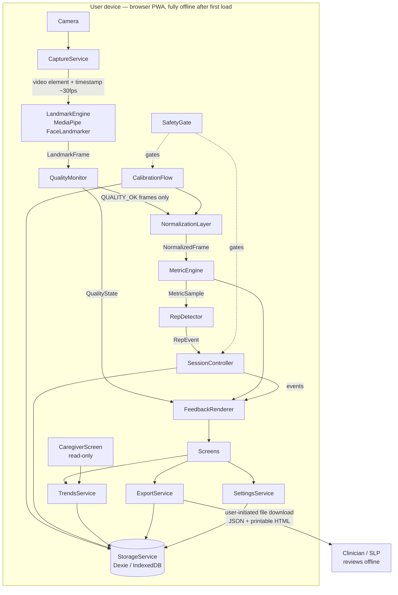

# MirrorWell — ARCHITECTURE.md

> **For AI coding agents:** this document is the single source of truth for MirrorWell's structure. Every identifier in §12 is canonical; all other docs reuse them verbatim. Full method-level contracts live in `API.md`; full schema DDL lives in `DATABASE.md`; both conform to this document. Two non-negotiables apply to every line of code: **(1) no network calls, ever** (CI-enforced), and **(2) no camera frame, video, or raw landmark array is ever persisted** — only derived numeric metrics.

**Architectural stance (decided):** MirrorWell is a **local-first Progressive Web App with no server**. All sensing, computation, and storage happen on the user's device. Clinician involvement is via user-initiated export files; caregiver involvement is via a read-only on-device view. This follows from the privacy-first constraint ("all on-device; no network required; frames never stored") and the simplest-design constraint. "Backend" throughout the doc set = the local service layer defined here.

## 1. System overview



Cadence: `CaptureService → LandmarkEngine → QualityMonitor → NormalizationLayer → MetricEngine → RepDetector → FeedbackRenderer` is the **hot path**, per-frame at ≥ 24 fps, running outside React. Everything below `SessionController` is event-driven.

## 2. Canonical tech stack

| Concern | Choice | Justification (one line) |
|---|---|---|
| Language | TypeScript 5.x | Typed contracts between tracks; AI-agent friendly. |
| UI | React 18.x | Mature, free, componentized screens. |
| Build/PWA | Vite 5.x + `vite-plugin-pwa` (**needs verification**) | Fast builds; offline-first install on both target platforms. |
| Face landmarks | `@mediapipe/tasks-vision` FaceLandmarker 0.10.x (**needs verification**) | Pretrained 478-point mesh + facial transformation matrix, on-device WASM/WebGPU, free. |
| Storage | Dexie 4.x (IndexedDB) | Typed offline persistence for numeric metrics only. |
| Charts | Recharts 2.x (**needs verification**) | Declarative trends chart. |
| Unit tests | Vitest (**needs verification**) + `fake-indexeddb` | Fast TS-native tests for metric math and storage. |
| E2E / a11y | Playwright 1.x + `@axe-core/playwright` (**needs verification**) | Chromium fake-camera replays fixtures deterministically; automated WCAG scans. |
| Server | **None** | Privacy-first; nothing to breach, no secrets to manage. |

**Version pinning rule:** IMPLEMENTATION Task 1 resolves every "needs verification" version to latest stable and records it here; thereafter this table is canonical and no other dependency may be added without updating it.

**Supported platforms (hard gates):** Windows desktop (Chromium, Firefox) and Android (Chrome). **Apple platforms are out of scope** — no code path may depend on them; no test targets them. **PWA installation** is supported on Chromium desktop and Android Chrome only; Firefox desktop does not support PWA install and runs MirrorWell as an **offline-capable browser tab** (the service worker still works) — Firefox remains a hard test gate regardless.

## 3. Components

| Component | Responsibility | Technology | Talks to |
|---|---|---|---|
| `CaptureService` | Own the camera: permission flow, frame loop (`requestVideoFrameCallback`, rAF fallback), teardown | `getUserMedia`, 640×480 min, front camera | → `LandmarkEngine` (video element + timestamp); ← `SessionController`/`CalibrationFlow` (start/stop) |
| `LandmarkEngine` | One job: frames in, landmarks out. Wraps the bundled FaceLandmarker model (`public/models/face_landmarker.task`) **and its bundled WASM runtime (`public/wasm/`, copied from the npm package at postinstall)** — both served same-origin, never CDN | MediaPipe tasks-vision, VIDEO mode via `detectForVideo`, transformation matrix enabled | ← `CaptureService`; → `QualityMonitor` |
| `QualityMonitor` | Gate every frame; emit exactly one `QualityState`; the fail-safe core | Pure TS; gates in `thresholds.ts` | ← `LandmarkEngine`; → `NormalizationLayer` (pass) or `FeedbackRenderer` (block reason) |
| `NormalizationLayer` | Make geometry pose/scale/identity-invariant: inter-ocular scaling, head-pose correction, neutral-baseline subtraction | Pure TS math | ← `QualityMonitor`; ← `CalibrationFlow` (baseline); → `MetricEngine` |
| `MetricEngine` | Compute `symmetryIndex` + `effortIndex` per frame for the active exercise; smoothing; ease-off condition | Pure TS math (deterministic, unit-tested) | ← `NormalizationLayer`; → `RepDetector`, `FeedbackRenderer` |
| `RepDetector` | Rep state machine over `MetricSample` streams | Pure TS | ← `MetricEngine`; → `SessionController` |
| `SessionController` | Session state machine (per exercise: DEMO→REPS→REST), event emitter (the frontend contract), session assembly + save | TS event emitter | ← `RepDetector`, `QualityMonitor`; → `StorageService`, `FeedbackRenderer`, screens |
| `FeedbackRenderer` | All in-session output: symmetry bar, guide arc, ease-off cue, rep ticks, quality messages; canvas at full fps, text ~15 Hz | Canvas 2D + DOM | ← `MetricEngine`, `QualityMonitor`, `SessionController`; → `SessionScreen` |
| `CalibrationFlow` | Neutral capture, per-exercise comfortable-max capture, noise-floor self-test, session-start re-check | TS orchestration over the hot path | → `NormalizationLayer`, `StorageService`; gated by `SafetyGate` |
| `SafetyGate` | Attestation gate + Demo Mode; blocks `SessionController.start` and `CalibrationFlow` until attested at current `consentVersion` | TS + `StorageService` | → everything session-related |
| `StorageService` | Sole owner of `mirrorwell_db`; validation; transactions; deletion | Dexie 4.x | ← all persisting services; no component touches IndexedDB directly |
| `TrendsService` | Aggregation by `trendGranularity`, baseline partitioning, noise-floor filtering | Pure TS over `StorageService` | ← `TrendsScreen`, `CaregiverScreen`, `ExportService` |
| `ExportService` | Clinician summary: JSON (schema `tests/schemas/export.schema.json`) + printable HTML; downloads only | Blob download, no share targets | ← `ExportScreen`; → `StorageService`, `TrendsService` |
| `SettingsService` | Validated read/update of the `app_settings` singleton | TS over `StorageService` | ← `SettingsScreen`, various |
| `DebugHud` (dev only) | Live pipeline introspection + numeric CSV capture for validation | React overlay, excluded from prod bundle | ← hot path taps |

Screens (`OnboardingScreen`, `CalibrationScreen`, `HomeScreen`, `SessionScreen`, `SummaryScreen`, `TrendsScreen`, `CaregiverScreen`, `ExportScreen`, `SettingsScreen`) are specified in `FRONTEND.md`; they consume only the module contracts in `API.md` and the `SessionController` events (§12).

## 4. Onboarding & per-user calibration

Uncalibrated cross-session data is misleading; this protocol is what makes every stored number valid and comparable.

1. **Attestation (`OnboardingScreen` → `SafetyGate.recordAttestation`)** — user confirms: diagnosed facial palsy; clinician-assigned exercises; 18+; understands the non-diagnostic scope. Red-flag education shown (SAFETY §3), including "new or sudden facial droop is a medical emergency." Cannot be skipped; re-runs if `consentVersion` changes. A clearly-labeled **"Try a demo"** path calls `SafetyGate.enterDemoMode()` instead (§12 Demo Mode rules: in-memory only, watermarked, nothing persisted, reload exits).
2. **Exercise selection** — user enables only the subset of `EX_*` exercises their therapist assigned → `user_profile.assignedExercises`.
3. **Neutral baseline (`CalibrationFlow.captureNeutral`)** — 3 captures × 3 s of relaxed face, live `QualityMonitor` coaching ("more light," "come closer"); median-aggregated per-region reference distances → `calibration_baseline.neutralStats`. `qualityScore` = fraction of capture frames that were `QUALITY_OK`; capture **rejected below 0.7** (`QUALITY_TOO_LOW`) — a bad baseline poisons everything downstream, so it is refused at the door.
4. **Comfortable max (`CalibrationFlow.captureComfortableMax`)** per assigned exercise — 3 *gentle* max reps (copy explicitly says "gentle — do not strain", per the NMR small-movement principle); **median** peak displacement (not max) → `calibration_baseline.comfortableMax[exerciseId]`.
5. **Noise-floor self-test** — 3 additional neutral captures under the user's real conditions; observed spread of `symmetryIndex` at rest → `app_settings.noiseFloorSymmetry` (default 0.05 until measured). `TrendsService` suppresses any period-over-period change smaller than this value (rendered "steady", `aboveNoiseFloor: false`).
6. **Validity rules** — every `session_record` stores its `baselineId`; `TrendsService` never mixes baselines in one series. At each session start a 3 s silent neutral re-check runs; resting displacement deviating > 8% from `neutralStats` prompts recalibration instead of recording a misleading session (threshold in `thresholds.ts`, **needs verification**). Scheduled recalibration prompt every 14 days (design default, **needs verification**).

## 5. Data flows — two full round trips

### 5.1 Live guided-exercise session (one gentle-smile rep)

1. `HomeScreen` → "Start my exercises" → `SessionController.start(profile.assignedExercises)`. `SafetyGate.isAttested()` must return true (else `NOT_ATTESTED` and redirect to `OnboardingScreen`). `NormalizationLayer.setBaseline(activeBaseline)`; silent neutral re-check (§4.6) passes.
2. `SessionController` enters `DEMO` for `EX_SMILE` (plays `demoAssetPath` WebM); user taps "I'm ready" → `REPS`. `CaptureService.start()` begins delivering the video element + timestamps per frame tick.
3. Per frame: `LandmarkEngine.detect(video, timestampMs)` → `LandmarkFrame {landmarks[478], headPose, facePresent, timestampMs}` → `QualityMonitor.evaluate(video, lf)` → `QUALITY_OK` → `NormalizationLayer.normalize(lf)` → `NormalizedFrame {regionDisplacements: {REGION_MOUTH_CORNER: {left: 0.041, right: 0.028}}}` → `MetricEngine.compute(nf, 'EX_SMILE')` → `MetricSample {symmetryIndex: 0.68, effortIndex: 0.44, timestampMs}` (in `effortTargetZone`, no cue).
4. `FeedbackRenderer` updates the symmetry bar and arc ≤ 100 ms after capture; `SessionController` emits `metricUpdate` (throttled ~15 Hz) and `qualityUpdate` events consumed by `SessionScreen`.
5. `RepDetector.feed(sample)` sees effort cross `repStartThreshold` 0.15 → hold ≥ 800 ms → fall below `repEndThreshold` 0.10 → emits `RepEvent {repIndex: 4, peakSymmetryIndex: 0.71, peakEffortIndex: 0.47, durationMs: 1900, easeOffTriggered: false}` → `SessionController` emits `repCompleted` → tick + haptic (Android) / tone (desktop).
6. Mid-rep failure case: user's lamp dips → `QualityMonitor` returns `LOW_LIGHT` → hot path short-circuits **before** `NormalizationLayer` (structural, not policy) → `FeedbackRenderer` shows "More light needed", scoring paused → if < 60% of the rep's frames were `QUALITY_OK`, the rep is discarded with a gentle explanation.
7. After configured `repsPerSet`, state → `REST` (`restSeconds`, extendable, never shortenable by pressure); next exercise; on completion `SessionController.stop('completed')` assembles `SessionRecord` + nested `exercise_result` + `rep_metric` rows → `StorageService.saveSession(s)` in **one Dexie transaction** → `sessionEnded` event → `SummaryScreen` renders from the returned record. All frames/landmarks from the session are already garbage-collected; nothing visual was ever persisted.

### 5.2 Caregiver/clinician reviewing progress

1. Patient enables `caregiverViewEnabled` in `SettingsScreen` (`SettingsService.update({caregiverViewEnabled: true})`) — off by default; the toggle is the consent act.
2. Caregiver (on the patient's device) opens `CaregiverScreen` from `HomeScreen` (entry visible only when enabled; deep links redirect to `HomeScreen` when disabled). Screen calls `TrendsService.getTrend(exerciseId, granularity)` per assigned exercise and `StorageService.getSessions(range)` for adherence stats and the last-session summary. Every element is read-only; banner: "Read-only view, enabled by the device owner."
3. `TrendsService` aggregates within the active `baselineId` only, applies `noiseFloorSymmetry` filtering, and returns `TrendSeries` — the caregiver sees the same honest picture the patient does, plus `lowQualityFramePct` so data quality is visible, never hidden.
4. For the therapist appointment: patient opens `ExportScreen` → `ExportService.generateSummary({from, to})` → validates against `tests/schemas/export.schema.json` → downloads `mirrorwell-summary-<date>.json` + `.html` (printable, one A4 page). The HTML header states the non-diagnostic scope so a clinician seeing it cold isn't misled. No network is involved at any step — the patient physically carries/sends the file (`ExportScreen` advises sharing only with the care team).

## 6. ML integration points

Exactly **one** model, quarantined behind one interface. Everything downstream is deterministic geometry — the only fairness/robustness risk surface is this component (MODEL_AND_DATA.md owns its validation).

| Property | Contract |
|---|---|
| Call site | `LandmarkEngine.detect(video, timestampMs)` — hot path, per frame |
| Model | MediaPipe FaceLandmarker (`face_landmarker.task`, ~3 MB, bundled at `public/models/`) + the tasks-vision **WASM runtime bundled at `public/wasm/`** (copied from the npm package at postinstall; `FilesetResolver` points at it, never a CDN). Both hash-verified against `models.lock.json`. |
| Inference | **On-device only** (WASM, WebGPU delegate where available). Remote inference is forbidden — it would violate the no-network rule and stream faces off-device. |
| Input | The playing `HTMLVideoElement` (camera stream ≥ 640×480) passed to `detectForVideo` with a timestamp — the model handles conversion internally; we never preprocess |
| Output | `LandmarkFrame { landmarks: Point3D[478] (x,y,z floats, normalized image coords), headPose: Matrix4 (facial transformation matrix, row-major float[16]), facePresent: boolean (faceLandmarks non-empty — the result exposes no per-frame confidence; sensitivity is set via the minFaceDetectionConfidence/minFacePresenceConfidence/minTrackingConfidence options, defaults 0.5), timestampMs: number }` |
| Failure | `MODEL_LOAD_FAILED` at init (blocking screen, retry); `INFERENCE_FAILED` per frame (counts as `FACE_LOST` for gating) |
| Downstream | `NormalizationLayer` consumes **raw landmark coordinates**, not blendshapes — blendshapes are more prior-laden on atypical faces (MODEL_AND_DATA §2) |

## 7. Metric definitions (canonical math)

For the active exercise's region pair with baseline-subtracted, pose-corrected, inter-ocular-scaled displacements `dL`, `dR`:

- `symmetryIndex = min(dL, dR) / max(dL, dR)` ∈ [0,1]; if `max(dL, dR) < movementFloor` (0.8% of inter-ocular distance) the sample is `null` — no movement, no score.
- `effortIndex = max(dL, dR) / comfortableMax[exerciseId]`; `effortTargetZone = [0.30, 0.50]` (**needs verification**); ease-off cue fires when `effortIndex > 0.60` sustained ≥ 300 ms.
- Both smoothed with a 5-frame rolling median before display or rep detection.
- Rep = `effortIndex` rises above 0.15 (`repStartThreshold`), stays ≥ 800 ms (`repMinDurationMs`), falls below 0.10 (`repEndThreshold`).
- All values live in `src/config/thresholds.ts`, each commented with its owning doc section; initial gate values: `LOW_LIGHT` mean luma < 60/255; `TOO_FAR` inter-ocular < 60 px; `POSE_OUT_OF_RANGE` |yaw|/|pitch|/|roll| > 15°; `LOW_CONFIDENCE` resting frame-to-frame landmark displacement > 0.5% of inter-ocular distance. All labeled "initial value — tuned against fixtures."

## 8. Fail-safe sensing (canonical)

`QualityMonitor` emits exactly one state per frame: `QUALITY_OK`, `LOW_LIGHT`, `FACE_LOST`, `TOO_FAR`, `POSE_OUT_OF_RANGE`, `LOW_CONFIDENCE`. Hard rules: metrics are computed **only** on `QUALITY_OK` frames (enforced structurally — the quality gate sits before `NormalizationLayer` in the pipeline); a rep with < 60% `QUALITY_OK` frames is discarded and gently explained; problems persisting > 30 s offer session end (`endReason: 'quality_abandoned'`, excluded from trends). The app never shows a confident number derived from bad input — the UX for each state is specified in FRONTEND.md §5.

## 9. Secrets & config

**There are no secrets.** No API keys, tokens, accounts, or third-party services exist anywhere in this system — that is a design guarantee, not an accident. What exists is non-secret build configuration:

```bash
# .env.example  — copy to .env; ALL values are non-secret build flags.
# RULE (non-negotiable): no variable containing a credential, token, or key
# may ever be added to this file or this codebase. If a feature seems to need
# one, the feature violates the no-network architecture — redesign it.
VITE_CONSENT_VERSION=1          # bump forces re-onboarding for all users
VITE_ENABLE_DEBUG_HUD=false     # true only in dev; HUD is tree-shaken from prod builds
VITE_DEMO_MODE_ENABLED=true     # shows "Try a demo" entry on OnboardingScreen
```

`.env` is git-ignored; `.env.example` is committed. Client-side exposure risk: none from config (nothing sensitive exists to expose). The actual sensitive asset is **user health data in IndexedDB**, readable by anyone with device access — policy and compensating controls (device-lock guidance, minimization, one-tap deletion) are owned by SAFETY_AND_COMPLIANCE §6. **CI enforcement:** a Playwright check intercepts all network requests after page load and fails the build if any outbound request occurs (same-origin asset loads only).

## 10. Non-functional targets

- Hot path ≥ **24 fps** on a 2020-era mid-range Windows laptop (Intel i5, integrated graphics) and a mid-range Android phone; capture-to-feedback latency ≤ **100 ms**; never queue frames — always process latest, drop stale.
- Cold start ≤ 5 s including model load; PWA fully offline after first load (verified in airplane mode).
- Storage growth ≤ ~5 MB/year at daily use; `StorageService.deleteAllData()` completes in one user action.
- If `mirrorwell_db` cannot open (private-browsing restrictions): plain-language blocking notice; **no calibration or sessions run un-persisted** (would break trend integrity). Demo Mode is exempt — it never persists anyway.
- Timestamps: stored **UTC ISO 8601**, displayed local; trend periods = calendar months / ISO weeks in local time.
- Fairness: subgroup gaps in MODEL_AND_DATA §5 are release blockers and count as non-functional requirements of this architecture.
- Accessibility: WCAG 2.1 AA minimum (FRONTEND.md §4 owns the per-screen requirements).

## 11. Demo Mode (canonical rules)

`SafetyGate.enterDemoMode()` sets an **in-memory** `demoMode` flag (never persisted). In demo mode: intended-use notice shown first; ephemeral quick-calibration (1×3 s neutral + 1 gentle-max rep, memory only — runs as an inline "quick setup" overlay at the start of `SessionScreen`; `CalibrationScreen` is never used in demo); `StorageService` writes disabled (structurally — the service refuses writes while `demoMode` is true); persistent watermark "DEMO — not for exercise use" on `SessionScreen`/`SummaryScreen`; `TrendsScreen`, `ExportScreen`, `CaregiverScreen` unreachable; page reload exits completely. Purpose: evaluators/judges can experience the interaction without attesting and without creating health records.

## 12. Canonical identifiers appendix (the glossary — reuse verbatim, everywhere)

| Kind | Identifiers |
|---|---|
| Services | `CaptureService`, `LandmarkEngine`, `QualityMonitor`, `NormalizationLayer`, `MetricEngine`, `RepDetector`, `SessionController`, `FeedbackRenderer`, `CalibrationFlow`, `SafetyGate`, `StorageService`, `TrendsService`, `ExportService`, `SettingsService`, `DebugHud` (dev) |
| Screens | `OnboardingScreen`, `CalibrationScreen`, `HomeScreen`, `SessionScreen`, `SummaryScreen`, `TrendsScreen`, `CaregiverScreen`, `ExportScreen`, `SettingsScreen` |
| Database | `mirrorwell_db` v1; tables `user_profile`, `calibration_baseline`, `session_record`, `exercise_result`, `rep_metric`, `app_settings` (full DDL: DATABASE.md) |
| Key fields | `profileId`, `affectedSide`, `assignedExercises`, `attestedAt`, `consentVersion`, `baselineId`, `neutralStats`, `comfortableMax`, `qualityScore`, `isActive`, `sessionId`, `startedAt`, `endedAt`, `endReason`, `resultId`, `exerciseId`, `repsCompleted`, `meanSymmetryIndex`, `meanEffortIndex`, `easeOffCount`, `lowQualityFramePct`, `repId`, `repIndex`, `peakSymmetryIndex`, `peakEffortIndex`, `durationMs`, `easeOffTriggered`, `settingsId`, `highContrast`, `textScale`, `hapticsEnabled`, `audioCuesEnabled`, `reducedFacePreview`, `trendGranularity`, `noiseFloorSymmetry`, `showAffectedSideMarker`, `caregiverViewEnabled` |
| Exercises (`ExerciseId`) | `EX_BROW_RAISE`, `EX_EYE_CLOSURE`, `EX_SMILE`, `EX_PUCKER` — config fields per exercise: `exerciseId`, `regionId`, landmark indices, display name, instruction, `demoAssetPath`, `repsPerSet` (10; `EX_EYE_CLOSURE` 5), `sets` (1), `restSeconds` (20) — dosing fixed in v1, **needs verification** |
| Regions (`RegionId`) | `REGION_BROW`, `REGION_EYELID`, `REGION_MOUTH_CORNER`, `REGION_LIP` (1:1 with exercises above) |
| Metrics & types | `symmetryIndex`, `effortIndex`, `effortTargetZone`, `movementFloor`, `MetricSample`, `RepEvent`, `LandmarkFrame`, `NormalizedFrame`, `NeutralStats`, `UserProfile`, `CalibrationBaseline`, `SessionRecord`, `SessionRecordInput`, `SessionRecordFull`, `AppSettings`, `AppStateContext`, `TrendSeries`, `MirrorWellError` |
| Quality states (`QualityState`) | `QUALITY_OK`, `LOW_LIGHT`, `FACE_LOST`, `TOO_FAR`, `POSE_OUT_OF_RANGE`, `LOW_CONFIDENCE` |
| Session states / `EndReason` | `DEMO`, `REPS`, `REST`; `'completed' \| 'user_stopped' \| 'red_flag_stopped' \| 'quality_abandoned'` |
| `SessionController` events | `stateChanged {exerciseId, state}`, `metricUpdate {sample}`, `qualityUpdate {state}`, `repCompleted {event}`, `easeOff {active}`, `sessionEnded {record}` — no other events exist |
| Error codes | `DB_UNAVAILABLE`, `VALIDATION_FAILED`, `QUALITY_TOO_LOW`, `MODEL_LOAD_FAILED`, `NOT_INITIALIZED`, `INFERENCE_FAILED`, `NO_BASELINE`, `POSE_OUT_OF_RANGE`, `NOT_ATTESTED`, `CAMERA_DENIED`, `CAMERA_UNAVAILABLE` (shapes: API.md §1) |
| Config files | `src/config/exercises.ts`, `src/config/thresholds.ts`, `src/config/strings.ts`; env flags `VITE_CONSENT_VERSION`, `VITE_ENABLE_DEBUG_HUD`, `VITE_DEMO_MODE_ENABLED` |
| Test artifacts | masters `tests/fixtures/masters/fixture_<subjectId>_<condition>.{webm,mp4}` + Playwright replays `tests/fixtures/replay/fixture_<subjectId>_<condition>.mjpeg` (ffmpeg-converted — Chromium fake capture accepts only `.y4m`/`.mjpeg`), `tests/fixtures/fixtures_manifest.json` (tracks both paths), `tests/schemas/export.schema.json`, DebugHud CSV columns `timestampMs, exerciseId, qualityState, symmetryIndexRaw, symmetryIndexSmoothed, effortIndexRaw, effortIndexSmoothed, repState, fps` |
