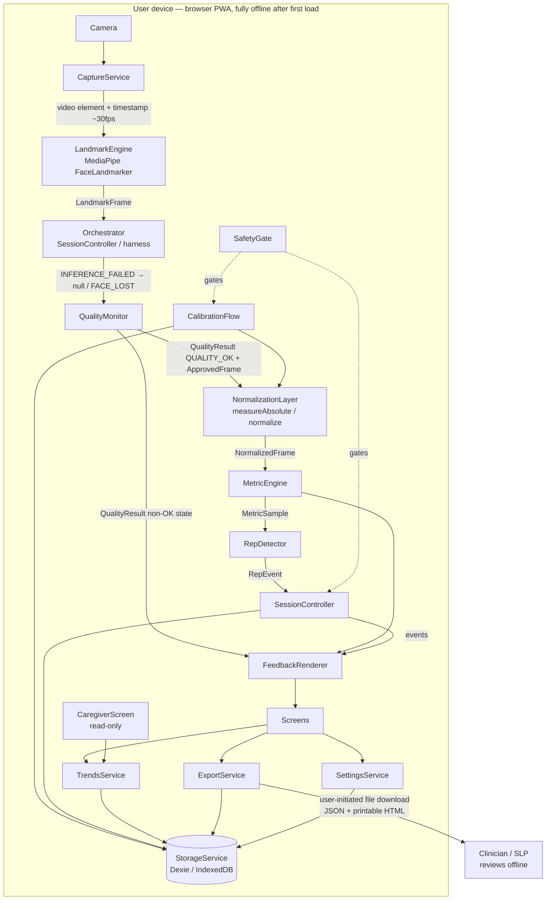

# MirrorWell — ARCHITECTURE.md

> **For AI coding agents:** this document is the single source of truth for MirrorWell's structure. Every identifier in §12 is canonical; all other docs reuse them verbatim. Full method-level contracts live in `API.md`; full schema DDL lives in `DATABASE.md`; both conform to this document. Two non-negotiables apply to every line of code: **(1) no network calls, ever** (CI-enforced), and **(2) no camera frame, video, or raw landmark array is ever persisted** — only derived numeric metrics.

**Architectural stance (decided):** MirrorWell is a **local-first Progressive Web App with no server**. All sensing, computation, and storage happen on the user's device. Clinician involvement is via user-initiated export files; caregiver involvement is via a read-only on-device view. This follows from the privacy-first constraint ("all on-device; no network required; frames never stored") and the simplest-design constraint. "Backend" throughout the doc set = the local service layer defined here.

## 1. System overview



Cadence: `CaptureService → LandmarkEngine → QualityMonitor → NormalizationLayer → MetricEngine → RepDetector → FeedbackRenderer` is the **hot path**, per-frame at ≥ 24 fps, running outside React. The orchestrator (`SessionController`, or a dev harness under `src/dev/`) converts `INFERENCE_FAILED` before `evaluate` and only passes `ApprovedFrame` into geometry/normalize. Everything below `SessionController` is event-driven.

## 2. Canonical tech stack

| Concern | Choice | Justification (one line) |
|---|---|---|
| Language | TypeScript 5.9.3 | Typed contracts between tracks; AI-agent friendly. |
| UI | React 18.3.1 + react-dom 18.3.1 | Mature, free, componentized screens. |
| Build/PWA | Vite 5.4.21 + `@vitejs/plugin-react` 5.2.0 + `vite-plugin-pwa` 1.3.0 | Fast builds; offline-first install on both target platforms. |
| Face landmarks | `@mediapipe/tasks-vision` FaceLandmarker 0.10.35 | Pretrained 478-point mesh + facial transformation matrix, on-device WASM, GPU delegate (backend not asserted; WebGPU unverified for 0.10.35), free. |
| Storage | Dexie 4.4.4 (IndexedDB) | Typed offline persistence for numeric metrics only. |
| Charts | Recharts 2.15.4 | Declarative trends chart. |
| Unit tests | Vitest 3.2.7 + `fake-indexeddb` 6.2.5 + `@vitest/coverage-v8` 3.2.7 | Fast TS-native tests for metric math and storage; coverage-v8 measures the Task 7 100%-branch-coverage hard requirement (TESTS.md §2). |
| E2E / a11y | Playwright 1.61.1 (`@playwright/test`) + `@axe-core/playwright` 4.12.1 | Chromium fake-camera replays fixtures deterministically; automated WCAG scans. |
| Server | **None** | Privacy-first; nothing to breach, no secrets to manage. |

**UI-layer dependencies (Gate 0 frontend salvage, 2026-07-22).** The salvaged screen layer adds the following, exact-pinned (no `^`). All run fully offline at runtime — no web fonts, no CDN, no `@import url(...)`; Tailwind is build-time only. No state library is permitted (Redux/Zustand forbidden — React context + hooks only).

| Package | Version | Kind | Purpose (offline, no network at runtime) |
|---|---|---|---|
| `react-router-dom` | 6.30.1 | dep | Client routing per FRONTEND.md §1 navigation map + route guards. |
| `@radix-ui/react-checkbox` | 1.3.2 | dep | Accessible checkbox primitive (attestation, consent toggles). |
| `@radix-ui/react-label` | 2.1.7 | dep | Accessible label primitive. |
| `@radix-ui/react-slot` | 1.2.3 | dep | Composition primitive for the button/variant system. |
| `lucide-react` | 0.525.0 | dep | Icon set, bundled SVG (no network). |
| `clsx` | 2.1.1 | dep | Conditional className join. |
| `class-variance-authority` | 0.7.1 | dep | Typed component style variants. |
| `tailwind-merge` | 3.3.1 | dep | Deduplicates conflicting Tailwind classes. |
| `tailwindcss` | 3.4.17 | devDep | Build-time utility CSS (no runtime, no CDN). |
| `tailwindcss-animate` | 1.0.7 | devDep | Tailwind plugin for `fade-in` keyframe utilities (build-time). |
| `postcss` | 8.5.6 | devDep | Tailwind's build pipeline. |
| `autoprefixer` | 10.4.21 | devDep | Vendor-prefixing at build time. |

**Version pinning rule:** IMPLEMENTATION Task 1 resolves every "needs verification" version to latest stable and records it here; thereafter this table is canonical and no other dependency may be added without updating it.

**Resolution note (Task 1, 2026-07-09):** every exact version above is the latest stable release **within the major already fixed by this table** (Vite 5.x, React 18.x, TypeScript 5.x, Recharts 2.x, `@mediapipe/tasks-vision` 0.10.x, Playwright 1.x). Current npm `latest` tags for several of these packages point to newer majors (Vite 8, React 19, TypeScript 7, Recharts 3) that were **not** installed — bumping majors is a separate decision requiring its own doc amendment, not something Task 1's "resolve needs-verification" instruction authorizes. `@vitejs/plugin-react` 5.2.0 and `vitest` 3.2.7 were selected (over their newest majors, which require Vite ^8) specifically because their `peerDependencies` are compatible with the pinned Vite 5.x. `@types/node` 22.20.1 was added as a dev-only type-declarations package (not a stack "Concern" choice — required transitively by Vitest's own peer dependencies and by `process` usage in `playwright.config.ts`).

**Supported platforms (hard gates):** Windows desktop (Chromium, Firefox) and Android (Chrome). **Apple platforms are out of scope** — no code path may depend on them; no test targets them. **PWA installation** is supported on Chromium desktop and Android Chrome; Firefox 143+ on Windows supports web-app install; older Firefox runs as offline-capable tab; Firefox remains a hard test gate either way.

## 3. Components

| Component | Responsibility | Technology | Talks to |
|---|---|---|---|
| `CaptureService` | Own the camera: permission flow, frame loop (`requestVideoFrameCallback`, rAF fallback), teardown | `getUserMedia`, 640×480 min, front camera | → `LandmarkEngine` (video element + timestamp); ← `SessionController`/`CalibrationFlow` (start/stop) |
| `LandmarkEngine` | One job: frames in, landmarks out. Wraps the bundled FaceLandmarker model (`public/models/face_landmarker.task`) **and its bundled WASM runtime (`public/wasm/`, copied from the npm package at postinstall)** — both served same-origin, never CDN | MediaPipe tasks-vision, VIDEO mode via `detectForVideo`, transformation matrix enabled | ← `CaptureService`; → `QualityMonitor` |
| `QualityMonitor` | Gate every frame; return a discriminated `QualityResult` (`QUALITY_OK` carries branded `ApprovedFrame`; non-OK states carry no frame) | Pure TS; gates in `thresholds.ts`; `ApprovedFrame` constructible only inside `quality.ts` | ← orchestrator (`SessionController` / harness); → `NormalizationLayer`/`geometry` (via `ApprovedFrame`) or `FeedbackRenderer` (block reason) |
| `NormalizationLayer` | Make geometry scale/identity-invariant via the face-local geometry kernel (`measureAbsolute`) and neutral-baseline subtraction (`normalize`); both accept **only** `ApprovedFrame` | Pure TS math (`src/metrics/geometry.ts` kernel + `normalize.ts`) | ← `ApprovedFrame` from `QualityMonitor`; ← `CalibrationFlow` (baseline / bootstrap via `measureAbsolute`); → `MetricEngine` |
| `MetricEngine` | Compute `symmetryIndex` + `effortIndex` per frame for the active exercise; smoothing; ease-off condition | Pure TS math (deterministic, unit-tested) | ← `NormalizationLayer`; → `RepDetector`, `FeedbackRenderer` |
| `RepDetector` | Rep state machine over `MetricSample` streams | Pure TS | ← `MetricEngine`; → `SessionController` |
| `SessionController` | Session state machine (per exercise: DEMO→REPS→REST), event emitter (the frontend contract), session assembly + save | TS event emitter | ← `RepDetector`, `QualityMonitor`; → `StorageService`, `FeedbackRenderer`, screens |
| `FeedbackRenderer` | All in-session output: symmetry bar, effort meter (with `effortTargetZone` band), guide arc, ease-off cue, rep ticks, quality messages; canvas at full fps, text ~15 Hz | Canvas 2D + DOM | ← `MetricEngine`, `QualityMonitor`, `SessionController`; → `SessionScreen` |
| `CalibrationFlow` | Neutral capture, per-exercise comfortable-max capture, noise-floor self-test, session-start re-check | TS orchestration over the hot path | → `NormalizationLayer`, `StorageService`; gated by `SafetyGate` |
| `SafetyGate` | Attestation gate + Demo Mode; blocks `SessionController.start` and `CalibrationFlow` until attested at current `consentVersion` | TS + `StorageService` | → everything session-related |
| `StorageService` | Sole owner of `mirrorwell_db`; validation; transactions; deletion | Dexie 4.x | ← all persisting services; no component touches IndexedDB directly |
| `TrendsService` | Aggregation by `trendGranularity`, baseline partitioning, noise-floor filtering | Pure TS over `StorageService` | ← `TrendsScreen`, `CaregiverScreen`, `ExportService` |
| `ExportService` | Clinician summary: JSON (schema `tests/schemas/export.schema.json`) + printable HTML; downloads only | Blob download, no share targets | ← `ExportScreen`; → `StorageService`, `TrendsService` |
| `SettingsService` | Validated read/update of the `app_settings` singleton | TS over `StorageService` | ← `SettingsScreen`, various |
| `DebugHud` (dev only) | Live pipeline introspection + numeric CSV capture for validation | React overlay, excluded from prod bundle | ← hot path taps |

Screens (`OnboardingScreen`, `CalibrationScreen`, `HomeScreen`, `SessionScreen`, `SummaryScreen`, `TrendsScreen`, `CaregiverScreen`, `ExportScreen`, `SettingsScreen`) are specified in `FRONTEND.md`; they consume only the module contracts in `API.md` and the `SessionController` events (§12).

## 4. Onboarding & per-user calibration

Uncalibrated cross-session data is misleading; this protocol is what makes every stored number valid and comparable.

1. **Attestation (`OnboardingScreen` → `SafetyGate.recordAttestation`)** — user confirms: diagnosed facial palsy; clinician-assigned exercises; 18+; understands the non-diagnostic scope. Red-flag education shown (SAFETY §3), including "new or sudden facial droop is a medical emergency." Cannot be skipped; re-runs if `consentVersion` changes. A clearly-labeled **"Try a demo"** path calls `SafetyGate.enterDemoMode()` instead (§12 Demo Mode rules: in-memory only, watermarked, nothing persisted, reload exits).
2. **Exercise selection** — user enables only the subset of `EX_*` exercises their therapist assigned → `user_profile.assignedExercises`.
3. **Neutral baseline (`CalibrationFlow.captureNeutral`)** — 3 captures × 3 s of relaxed face, live `QualityMonitor` coaching ("more light," "come closer"); median-aggregated per-region face-local vectors (`{left,right}×{u,v}` in IOD units) → `calibration_baseline.neutralStats`; per assigned exercise, the median resting `max(mL,mR)` over the same approved frames → `calibration_baseline.neutralActivation[exerciseId]` (the effort rebase, §7). `qualityScore` = fraction of capture frames that were `QUALITY_OK`; capture **rejected below 0.7** (`QUALITY_TOO_LOW`) — a bad baseline poisons everything downstream, so it is refused at the door.
4. **Comfortable max (`CalibrationFlow.captureComfortableMax`)** per assigned exercise — 3 *gentle* max reps (copy explicitly says "gentle — do not strain", per the NMR small-movement principle); **median** peak displacement magnitude (not max) → `calibration_baseline.comfortableMax[exerciseId]`.
5. **Noise-floor self-test (`CalibrationFlow.runNoiseFloorSelfTest`)** — measured during calibration under the user's real conditions and stored on the **same** `calibration_baseline` row (not `app_settings`): (a) `noiseFloorDisplacement` = std of pre-floor `max(mL,mR)` over neutral `QUALITY_OK` frames; (b) `noiseFloorSymmetry` = std of smoothed `symmetryIndex` over held comfortable-max captures (SI is defined during held expression; at pure rest it is `null` under `movementFloor`). `TrendsService` reads the **active baseline's** `noiseFloorSymmetry` and suppresses any period-over-period change smaller than this value (rendered "steady", `aboveNoiseFloor: false`).
6. **Validity rules** — every `session_record` stores its `baselineId`; `TrendsService` never mixes baselines in one series. At each session start a 3 s silent neutral re-check runs (`CalibrationFlow.checkBaselineDrift`): per region/side, compare pre-floor displacement magnitudes `|m_current − m_neutral|` against stored neutral, aggregate as the median across regions; if that median exceeds `driftMaxPct` (0.08 in `thresholds.ts`, **needs verification**) → prompt recalibration instead of recording a misleading session. Scheduled recalibration prompt every 14 days (design default, **needs verification**).

## 5. Data flows — two full round trips

### 5.1 Live guided-exercise session (one gentle-smile rep)

1. `HomeScreen` → "Start my exercises" → `SessionController.start(profile.assignedExercises)`. `SafetyGate.isAttested()` must return true (else `NOT_ATTESTED` and redirect to `OnboardingScreen`). `NormalizationLayer.setBaseline(activeBaseline)`; silent neutral re-check (§4.6) passes.
2. `SessionController` enters `DEMO` for `EX_SMILE` (plays `demoAssetPath` WebM); user taps "I'm ready" → `REPS`. `CaptureService.start()` begins delivering the video element + timestamps per frame tick.
3. Per frame: `LandmarkEngine.detect(video, timestampMs)` → `LandmarkFrame` (shape: §13) → orchestrator catches `INFERENCE_FAILED` and passes `null` → `QualityMonitor.evaluate(video, lf)` → `QualityResult`. On `{ state: 'QUALITY_OK', frame: ApprovedFrame }` → `NormalizationLayer.normalize(af)` → `NormalizedFrame` with vector `regionDisplacements` (shape: §13) → `MetricEngine.compute(nf, 'EX_SMILE')` → `MetricSample` (in `effortTargetZone`, no cue). Non-OK `QualityResult` has no `frame` key — `normalize`/`measureAbsolute` are uncallable.
4. `FeedbackRenderer` updates the symmetry bar and arc ≤ 100 ms after capture; `SessionController` emits `metricUpdate` (throttled ~15 Hz) and `qualityUpdate` events consumed by `SessionScreen`.
5. `RepDetector.feed(sample)` sees effort cross `repStartThreshold` 0.15 → hold ≥ 800 ms → fall below `repEndThreshold` 0.10 → emits `RepEvent` (shape: §13) → `SessionController` emits `repCompleted` → tick + haptic (Android) / tone (desktop).
6. Mid-rep failure case: user's lamp dips → `QualityMonitor` returns `{ state: 'LOW_LIGHT' }` (no `frame`) → hot path cannot call `normalize` (type barrier, not policy) → `FeedbackRenderer` shows "More light needed", scoring paused → if < 60% of the rep's frames were `QUALITY_OK`, the rep is discarded with a gentle explanation.
7. After configured `repsPerSet`, state → `REST` (`restSeconds`, extendable, never shortenable by pressure); next exercise; on completion `SessionController.stop('completed')` assembles `SessionRecord` + nested `exercise_result` + `rep_metric` rows → `StorageService.saveSession(s)` in **one Dexie transaction** → `sessionEnded` event → `SummaryScreen` renders from the returned record. All frames/landmarks from the session are already garbage-collected; nothing visual was ever persisted.

### 5.2 Caregiver/clinician reviewing progress

1. Patient enables `caregiverViewEnabled` in `SettingsScreen` (`SettingsService.update({caregiverViewEnabled: true})`) — off by default; the toggle is the consent act.
2. Caregiver (on the patient's device) opens `CaregiverScreen` from `HomeScreen` (entry visible only when enabled; deep links redirect to `HomeScreen` when disabled). Screen calls `TrendsService.getTrend(exerciseId, granularity)` per assigned exercise and `StorageService.getSessions(range)` for adherence stats and the last-session summary. Every element is read-only; banner: "Read-only view, enabled by the device owner."
3. `TrendsService` aggregates within the active `baselineId` only, applies `noiseFloorSymmetry` filtering, and returns `TrendSeries` — the caregiver sees the same honest picture the patient does, plus `lowQualityFramePct` so data quality is visible, never hidden.
4. For the therapist appointment: patient opens `ExportScreen` → `ExportService.generateSummary({from, to})` → validates against `tests/schemas/export.schema.json` → downloads `mirrorwell-summary-<date>.json` + `.html` (printable, one A4 page). The HTML header states the non-diagnostic scope so a clinician seeing it cold isn't misled. No network is involved at any step — the patient physically carries/sends the file (`ExportScreen` advises sharing only with the care team).

## 6. ML integration points

Exactly **one** model, quarantined behind one interface. Everything downstream is deterministic geometry — the only fairness/robustness risk surface is this component (MODEL_AND_DATA.md owns its validation).

| Property | Contract |
|---|---|
| Call site | `LandmarkEngine.detect(video, timestampMs)` — hot path, per frame |
| Model | MediaPipe FaceLandmarker (`face_landmarker.task`, ~3 MB, bundled at `public/models/`) + the tasks-vision **WASM runtime bundled at `public/wasm/`** (copied from the npm package at postinstall; `FilesetResolver` points at it, never a CDN). Both hash-verified against `models.lock.json`. |
| Inference | **On-device only** (WASM, GPU delegate — backend not asserted; WebGPU unverified for 0.10.35). Remote inference is forbidden — it would violate the no-network rule and stream faces off-device. |
| Input | The playing `HTMLVideoElement` (camera stream ≥ 640×480) passed to `detectForVideo` with a timestamp — the model handles conversion internally; we never preprocess |
| Output | `LandmarkFrame { landmarks: Point3D[478] (x,y,z floats, normalized image coords), headPose: Matrix4 (facial transformation matrix, row-major float[16]), facePresent: boolean (faceLandmarks non-empty — the result exposes no per-frame confidence; sensitivity is set via the minFaceDetectionConfidence/minFacePresenceConfidence/minTrackingConfidence options, defaults 0.5), blendshapes: Record<string,number> (faceBlendshapes[0] categoryName → score; {} when absent), timestampMs: number }` |
| Failure | `MODEL_LOAD_FAILED` at init (blocking screen, retry); `INFERENCE_FAILED` per frame (counts as `FACE_LOST` for gating) |
| Downstream | `NormalizationLayer` consumes raw landmark coordinates; `MetricEngine` consumes `blendshapes` per-side scores as the SI/effort source (decision reversal per MODEL_AND_DATA §2/§7, 2026-07-19 — atypical-face risk gated at V2) |
| Telemetry release blocker | MediaPipe repo privacy notice mentions Tasks API utilization metrics; runtime network inspection of the pinned package must prove zero telemetry before release. |

## 7. Metric definitions (canonical math)

Canonical face-local 2D vector geometry. There is **no inverse-rotation pose correction** — rotation is an isometry (`‖R(a)−R(b)‖ = ‖a−b‖`), so "pose correction" by inverse rotation was a no-op and is deleted. Yaw/pitch are bounded by the ±15° quality gate; residual pose sensitivity is measured by bar **B3** (MODEL_AND_DATA §6) — honest envelope, not false invariance.

### Pixel space

`P = (x·W, y·H)` for landmark `(x, y)` and video frame size `W×H`. This maps MediaPipe's normalized image coords into pixel space and **fixes aspect distortion** (normalized coords alone stretch non-square frames). **Z is excluded in v1** (no defined metric scale on depth — documented; not a hidden assumption).

### Face-local frame

- `eyeR = landmarks[33]`, `eyeL = landmarks[263]` (anatomical left/right = **subject's** side, independent of mirrored preview).
- `origin = (eyeR + eyeL) / 2`
- `IOD = |eyeL − eyeR|` in pixels
- `û = (eyeL − eyeR) / IOD`  (+u = subject's anatomical left)
- `v̂` = `û` rotated 90° so +v points toward the forehead (sign fixed by a brow-raise fixture test)

**Invariances claimed honestly:** roll free from eye alignment; scale free from IOD division. **Not corrected:** yaw and pitch — the `POSE_OUT_OF_RANGE` gate bounds them to ±15°, and B3 measures residual SI change inside that envelope.

### Per-region features

For each region side, feature vector in IOD units:

`f = ((P_moving − P_anchor) · (û, v̂)) / IOD`  →  `{u, v}`

Anchors / movers:

| Region | Moving points | Anchor |
|---|---|---|
| `REGION_MOUTH_CORNER` | corners 61 / 291 | same-side eye center — mid(33,133) R / mid(263,362) L |
| `REGION_BROW` | brow points | same-side eye center |
| `REGION_EYELID` | upper/lower lid gap vector | eye center |
| `REGION_LIP` | lip corners | same-side eye center |

> Candidate `face-local-vector-v2` (2026-07-19): mouth/lip anchors moved from nose tip 1 to
> same-side eye centers. The nose tip sits off the face plane; under yaw its projection
> shifts by ~depth·sin(yaw), injecting a common-mode u error that collapsed SI at 10° yaw
> (V1 B3 rejection of `face-local-vector-v1` — `tests/analysis/rejected/`). Eye centers are
> planar and expression-static. Naive common-mode subtraction is forbidden: it maps
> unilateral motion to SI ≈ 1 (regression-tested in `tests/unit/geometry.test.ts`).

Exact mesh indices are fixed in IMPLEMENTATION Task 6 / geometry kernel code against the MediaPipe mesh map.

### NeutralStats

`NeutralStats = Record<RegionId, { left: {u,v}, right: {u,v} }>` — median per component over neutral `QUALITY_OK` frames (see ARCHITECTURE §13). Stored on `calibration_baseline.neutralStats`.

### Displacement, magnitudes, mirror

- `ΔL = f_L − neutral_L`, `ΔR = f_R − neutral_R`
- Mirror right onto left: `ΔR̃ = (−ΔR.u, ΔR.v)`
- Magnitudes: `mL = |ΔL|`, `mR = |ΔR̃|`

### symmetryIndex

- If `max(mL, mR) < movementFloorPct` (0.008 IOD) → `null` (no movement, no score).
- Else `SI = (min(mL, mR) / max(mL, mR)) · max(0, cosθ)`, where `cosθ = (ΔL · ΔR̃) / (mL · mR)` (0 if either magnitude is 0).
- Equal same-direction motion → SI ≈ 1; **equal-opposite motion → cosθ = −1 → SI = 0**; unilateral → SI = 0.

### effortIndex

`effortIndex = max(0, max(mL, mR) − neutralActivation[exerciseId]) / (comfortableMax[exerciseId] − neutralActivation[exerciseId])`, where `comfortableMax[exerciseId]` is the median of per-rep peak `max(mL, mR)` captured at calibration and `neutralActivation[exerciseId]` is the median RESTING `max(mL, mR)` captured during the neutral windows (baselines saved without the field behave as `neutralActivation = 0` in `MetricEngine` — but `SessionController.start` refuses them with `RECALIBRATION_REQUIRED`, so a session can never silently run the pre-rebase formula; the fallback only keeps old rows readable). The rebase is required because MediaPipe reports nonzero resting activation for some pairs (`browOuterUp`, `eyeBlink` commonly read 0.1–0.3 on a neutral face): unrebased, resting effort sits permanently above `repStartThreshold`/`repEndThreshold` for those exercises — a "rep" opens by itself at rest and can only close when the user drives the raw signal to zero with the OPPOSITE movement (furrowing for brow raise, eyes wide open for eye closure), while the intended movement pins effort over the ease-off ceiling. `symmetryIndex` stays on the raw per-side scores (it is a left/right ratio, not a magnitude against the calibrated span). `effortTargetZone = [0.30, 0.50]` (**needs verification**); ease-off cue fires when `effortIndex > 0.60` sustained ≥ 300 ms.

### Smoothing and gap rule

- Both SI and effort are smoothed with a **trailing** 5-frame median (frames `t−4..t` only — **not** a centered window; no lookahead delay).
- **Gap rule:** if the sample gap exceeds `metrics.gapResetMs` (250), the smoothing window and ease-off sustain accumulation **reset**; an active rep **aborts without emitting a `RepEvent`**.

### Rep detection

Rep = `effortIndex` rises above 0.15 (`repStartThreshold`), stays ≥ 800 ms (`repMinDurationMs`), falls below 0.10 (`repEndThreshold`). Gap abort (above) applies inside the active window.

### Quality gates (thresholds)

All values live in `src/config/thresholds.ts`, each commented with its owning doc section. Initial gate values (all labeled "initial value — tuned against fixtures"):

- `LOW_LIGHT` — mean luma over the **face bounding box** (landmark bbox +10% margin, sampled from the 64×64 downsample) < `lumaMin` 60/255
- `TOO_FAR` — inter-ocular distance < `interOcularMinFrac` × video width (`0.09`; fractional, not a fixed pixel count)
- `POSE_OUT_OF_RANGE` — |yaw| / |pitch| / |roll| > `poseMaxDeg` 15°
- `LOW_CONFIDENCE` — resting jitter (RMS second difference of landmarks / IOD) > `jitterMaxPct` 0.005

## 8. Fail-safe sensing (canonical)

`QualityMonitor.evaluate` returns exactly one `QualityResult` per frame. States: `QUALITY_OK`, `LOW_LIGHT`, `FACE_LOST`, `TOO_FAR`, `POSE_OUT_OF_RANGE`, `LOW_CONFIDENCE`. Hard rules: metrics are computed **only** on `QUALITY_OK` frames, enforced by a compile-time type barrier — `ApprovedFrame` is constructible only inside `quality.ts`; `normalize` / `measureAbsolute` accept only `ApprovedFrame`, so bad-frame metrics are a **compile error**, not a runtime policy. A rep with < 60% `QUALITY_OK` frames is discarded and gently explained; problems persisting > 30 s offer session end (`endReason: 'quality_abandoned'`, excluded from trends). The app never shows a confident number derived from bad input — the UX for each state is specified in FRONTEND.md §5.

## 9. Secrets & config

**There are no secrets.** No API keys, tokens, accounts, or third-party services exist anywhere in this system — that is a design guarantee, not an accident. What exists is non-secret build configuration:

```bash
# .env.example  — copy to .env; ALL values are non-secret build flags.
# RULE (non-negotiable): no variable containing a credential, token, or key
# may ever be added to this file or this codebase. If a feature seems to need
# one, the feature violates the no-network architecture — redesign it.
VITE_CONSENT_VERSION=1          # bump forces re-onboarding for all users
VITE_ENABLE_DEBUG_HUD=false     # true only in dev; HUD is tree-shaken from prod builds
VITE_DEMO_MODE_ENABLED=true     # shows "Try a demo" entry on OnboardingScreen
VITE_ENABLE_CAPTURE_HARNESS=false # dev-only fixture-capture harness
VITE_ENABLE_LIVE_DEMO=false     # dev-only live symmetry demo; replaces the V1 protocol harness
```

Every dev harness re-parents `CaptureService`'s single `<video>` element, so the dev-only mounts are **mutually exclusive by construction**: `VITE_ENABLE_LIVE_DEMO=true` swaps `LiveV1Harness` for `LiveDemoView` rather than mounting both (two consumers would leave one preview black). All of `src/dev/` is dropped from production builds regardless of these flags.

`.env` is git-ignored; `.env.example` is committed. Client-side exposure risk: none from config (nothing sensitive exists to expose). The actual sensitive asset is **user health data in IndexedDB**, readable by anyone with device access — policy and compensating controls (device-lock guidance, minimization, one-tap deletion) are owned by SAFETY_AND_COMPLIANCE §6. **CI enforcement:** a Playwright check intercepts all network requests after page load and fails the build if any outbound request occurs (same-origin asset loads only).

## 10. Non-functional targets

- Hot path ≥ **24 fps** on a 2020-era mid-range Windows laptop (Intel i5, integrated graphics) and a mid-range Android phone; capture-to-feedback latency ≤ **100 ms**; never queue frames — always process latest, drop stale.
- Cold start ≤ 5 s including model load; PWA fully offline after first load (verified in airplane mode).
- Storage growth ≤ ~5 MB/year at daily use; `StorageService.deleteAllData()` completes in one user action.
- If `mirrorwell_db` cannot open (private-browsing restrictions): plain-language blocking notice; **no calibration or sessions run un-persisted** (would break trend integrity). Demo Mode is exempt — it never persists anyway.
- Timestamps: stored **UTC ISO 8601**, displayed local; trend periods = calendar months / ISO weeks in local time.
- Fairness: subgroup gaps in MODEL_AND_DATA §5 are release blockers and count as non-functional requirements of this architecture.
- Accessibility: WCAG 2.1 AA minimum (FRONTEND.md §4 owns the per-screen requirements).

## 11. Demo Mode (canonical rules)

`SafetyGate.enterDemoMode()` sets an **in-memory** `demoMode` flag (never persisted). In demo mode: intended-use notice shown first; ephemeral quick-calibration (1×3 s neutral + 1 gentle-max rep, memory only — runs as an inline "quick setup" overlay at the start of `SessionScreen`; `CalibrationScreen` is never used in demo; the gentle-rep peak must reach `thresholds.blendshapes.activationFloor` or the setup throws `NO_BASELINE` — a noise-level `comfortableMax` from a user who held still would make `effortIndex` read sensor noise as full-effort movement and fire phantom reps); `StorageService` writes disabled (structurally — the service refuses writes while `demoMode` is true); persistent watermark "DEMO — not for exercise use" on `SessionScreen`/`SummaryScreen`; `TrendsScreen`, `ExportScreen`, `CaregiverScreen` unreachable; page reload exits completely, and so does reaching `OnboardingScreen` — which is the documented close-out of the demo journey (`SessionScreen` → `SummaryScreen` → `OnboardingScreen`, FRONTEND §1/§2.5, API §17). `/onboarding` therefore admits DEMO as well as UNATTESTED, and the screen calls `SafetyGate.exitDemoMode()` on mount, then re-derives the gate from `isAttested()`. Purpose: evaluators/judges can experience the interaction without attesting and without creating health records.

## 12. Canonical identifiers appendix (the glossary — reuse verbatim, everywhere)

| Kind | Identifiers |
|---|---|
| Services | `CaptureService`, `LandmarkEngine`, `QualityMonitor`, `NormalizationLayer`, `MetricEngine`, `RepDetector`, `SessionController`, `FeedbackRenderer`, `CalibrationFlow`, `SafetyGate`, `StorageService`, `TrendsService`, `ExportService`, `SettingsService`, `DebugHud` (dev) |
| Screens | `OnboardingScreen`, `CalibrationScreen`, `HomeScreen`, `SessionScreen`, `SummaryScreen`, `TrendsScreen`, `CaregiverScreen`, `ExportScreen`, `SettingsScreen` |
| Database | `mirrorwell_db` v1; tables `user_profile`, `calibration_baseline`, `session_record`, `exercise_result`, `rep_metric`, `app_settings` (full DDL: DATABASE.md) |
| Key fields | `profileId`, `affectedSide`, `assignedExercises`, `attestedAt`, `consentVersion`, `baselineId`, `neutralStats`, `comfortableMax`, `neutralActivation` (on `calibration_baseline`; optional — pre-field rows behave as 0), `qualityScore`, `isActive`, `noiseFloorSymmetry` (on `calibration_baseline`, not `app_settings`), `noiseFloorDisplacement` (on `calibration_baseline`), `sessionId`, `startedAt`, `endedAt`, `endReason`, `resultId`, `exerciseId`, `repsCompleted`, `meanSymmetryIndex`, `meanEffortIndex`, `easeOffCount`, `lowQualityFramePct`, `repId`, `repIndex`, `peakSymmetryIndex`, `peakEffortIndex`, `durationMs`, `easeOffTriggered`, `settingsId`, `highContrast`, `textScale`, `hapticsEnabled`, `audioCuesEnabled`, `reducedFacePreview`, `trendGranularity`, `showAffectedSideMarker`, `caregiverViewEnabled` |
| Exercises (`ExerciseId`) | `EX_BROW_RAISE`, `EX_EYE_CLOSURE`, `EX_SMILE`, `EX_PUCKER` — config fields per exercise: `exerciseId`, `regionId`, landmark indices, display name, instruction, `demoAssetPath`, `repsPerSet` (10; `EX_EYE_CLOSURE` 5), `sets` (1), `restSeconds` (20) — dosing fixed in v1, **needs verification** |
| Regions (`RegionId`) | `REGION_BROW`, `REGION_EYELID`, `REGION_MOUTH_CORNER`, `REGION_LIP` (1:1 with exercises above) |
| Metrics & types | `symmetryIndex`, `effortIndex`, `effortTargetZone`, `movementFloor`, `Vec2`, `LandmarkFrame`, `ApprovedFrame`, `QualityResult`, `AbsoluteFeatures`, `NeutralStats`, `NormalizedFrame`, `MetricSample`, `RepEvent`, `NeutralCaptureResult`, `UserProfile`, `CalibrationBaseline`, `SessionRecord`, `SessionRecordInput`, `SessionRecordFull`, `AppSettings`, `AppStateContext`, `TrendSeries`, `Adherence`, `MirrorWellError` — exact TS shapes: **§13** |
| Quality states (`QualityState`) | `QUALITY_OK`, `LOW_LIGHT`, `FACE_LOST`, `TOO_FAR`, `POSE_OUT_OF_RANGE`, `LOW_CONFIDENCE` |
| Session states / `EndReason` | `DEMO`, `REPS`, `REST`; `'completed' \| 'user_stopped' \| 'red_flag_stopped' \| 'quality_abandoned'` |
| `SessionController` events | `stateChanged {exerciseId, state}`, `metricUpdate {sample}`, `qualityUpdate {state}`, `repCompleted {event}`, `easeOff {active}`, `sessionEnded {record}`, `qualityOfferStop {visible}` — no other events exist |
| Error codes | `DB_UNAVAILABLE`, `VALIDATION_FAILED`, `QUALITY_TOO_LOW`, `MODEL_LOAD_FAILED`, `NOT_INITIALIZED`, `INFERENCE_FAILED`, `NO_BASELINE`, `RECALIBRATION_REQUIRED`, `POSE_OUT_OF_RANGE`, `NOT_ATTESTED`, `CAMERA_DENIED`, `CAMERA_UNAVAILABLE` (shapes: API.md §1) |
| Config files | `src/config/exercises.ts`, `src/config/thresholds.ts`, `src/config/strings.ts`; env flags `VITE_CONSENT_VERSION`, `VITE_ENABLE_DEBUG_HUD`, `VITE_DEMO_MODE_ENABLED`, `VITE_ENABLE_CAPTURE_HARNESS` (dev-only capture harness), `VITE_ENABLE_LIVE_DEMO` (dev-only live symmetry demo), `VITE_ENABLE_LIVE_V1_HARNESS` (dev-only V1 protocol harness; opt-in since the product app is the default DEV mount) |
| UI shell (frontend) | `App`, `AppStateProvider` (root context provider for `AppStateContext`), `RouteGuard`/`GateRoute`, `RootRedirect`, `CaregiverRoute` — the frozen router+context shell wiring the nine screens (FRONTEND §3); screen-local presentational components are implementation detail of their owning screen and not glossary identifiers |
| Test artifacts | masters `tests/fixtures/masters/fixture_<subjectId>_<condition>.{webm,mp4}` + Playwright replays `tests/fixtures/replay/fixture_<subjectId>_<condition>.mjpeg` (ffmpeg-converted — Chromium fake capture accepts only `.y4m`/`.mjpeg`), `tests/fixtures/fixtures_manifest.json` (tracks both paths), `tests/schemas/export.schema.json`, DebugHud CSV columns `timestampMs, exerciseId, qualityState, symmetryIndexRaw, symmetryIndexSmoothed, effortIndexRaw, effortIndexSmoothed, repState, fps` |

## 13. Canonical type definitions

Exact TypeScript shapes for every load-bearing pipeline and session type. Other docs **reference this section** instead of restating full shapes. Row types (`UserProfile`, `CalibrationBaseline`, `SessionRecord`, `ExerciseResult`, `RepMetric`, `AppSettings`) remain owned by `DATABASE.md` §2 and are not duplicated here.

```typescript
// --- Hot-path sensing & geometry ---

type LandmarkFrame = {
  landmarks: { x: number; y: number; z: number }[]; // length 478
  headPose: number[]; // 16 floats, row-major 4×4 facial transformation matrix
  facePresent: boolean; // faceLandmarks non-empty (no per-frame confidence field exists)
  blendshapes: Record<string, number>; // faceBlendshapes[0] categoryName → score; {} when absent
  timestampMs: number;
};

// Branded ApprovedFrame — brand symbol is not exported; only quality.ts constructs
type ApprovedFrame = {
  readonly __approved: unique symbol; // brand, not for external construction
  lf: LandmarkFrame;
  videoWidth: number;
  videoHeight: number;
};

type QualityState =
  | 'QUALITY_OK'
  | 'LOW_LIGHT'
  | 'FACE_LOST'
  | 'TOO_FAR'
  | 'POSE_OUT_OF_RANGE'
  | 'LOW_CONFIDENCE';

type QualityResult =
  | { state: 'QUALITY_OK'; frame: ApprovedFrame }
  | { state: Exclude<QualityState, 'QUALITY_OK'> }; // no frame key

// Face-local 2D vector features in inter-ocular-distance (IOD) units
type Vec2 = { u: number; v: number };
type AbsoluteFeatures = Record<RegionId, { left: Vec2; right: Vec2 }>;
type NeutralStats = Record<RegionId, { left: Vec2; right: Vec2 }>;

// NormalizedFrame carries vector displacements (not scalars)
type NormalizedFrame = {
  regionDisplacements: Record<RegionId, { left: Vec2; right: Vec2 }>;
  timestampMs: number;
};

type MetricSample = {
  symmetryIndex: number | null; // null under movementFloor
  effortIndex: number;
  timestampMs: number;
};

type RepEvent = {
  repIndex: number;
  peakSymmetryIndex: number | null;
  peakEffortIndex: number;
  durationMs: number;
  easeOffTriggered: boolean; // boolean on the event surface; StorageService stores 0|1
};

type NeutralCaptureResult = {
  neutralStats: NeutralStats;
  qualityScore: number; // [0..1]; < 0.7 → QUALITY_TOO_LOW
};

// --- Session assembly (StorageService / SessionController) ---

// Nested write shape for saveSession (one transaction).
// easeOffTriggered is 0|1 here for IndexedDB indexability (DATABASE.md §1).
type SessionRecordInput = {
  sessionId: string;
  profileId: string;
  baselineId: string;
  startedAt: string; // UTC ISO 8601
  endedAt: string;
  endReason: EndReason;
  results: Array<{
    resultId: string;
    exerciseId: ExerciseId;
    repsCompleted: number;
    meanSymmetryIndex: number | null;
    meanEffortIndex: number | null;
    easeOffCount: number;
    lowQualityFramePct: number;
    reps: Array<{
      repId: string;
      repIndex: number;
      peakSymmetryIndex: number | null;
      peakEffortIndex: number;
      durationMs: number;
      easeOffTriggered: 0 | 1;
    }>;
  }>;
};

// Nested read shape returned by getSessions / SessionController.stop / sessionEnded
type SessionRecordFull = SessionRecordInput;

// --- Trends & UI shell ---

type TrendSeries = {
  exerciseId: ExerciseId;
  granularity: 'weekly' | 'monthly';
  baselineId: string;
  points: Array<{
    periodStart: string; // calendar date in local time, ISO date
    meanSymmetryIndex: number;
    sampleCount: number;
    aboveNoiseFloor: boolean;
  }>;
};

type Adherence = {
  sessionsPerWeek: number[];
  completionRate: number; // completed sessions / started sessions in range
};

// Root React context (FRONTEND.md §3) — not a pipeline type
type AppStateContext = {
  profile: UserProfile | null;
  activeBaseline: CalibrationBaseline | null;
  settings: AppSettings;
  gate: 'UNATTESTED' | 'ATTESTED' | 'DEMO';
};
```

**Type-barrier rule (binding):** `ApprovedFrame` is constructible only inside `src/sensing/quality.ts`. `NormalizationLayer.normalize` and the geometry kernel `measureAbsolute` accept only `ApprovedFrame`. Passing a raw `LandmarkFrame` into either is a compile error — metric code on a non-`QUALITY_OK` frame is structurally impossible.
