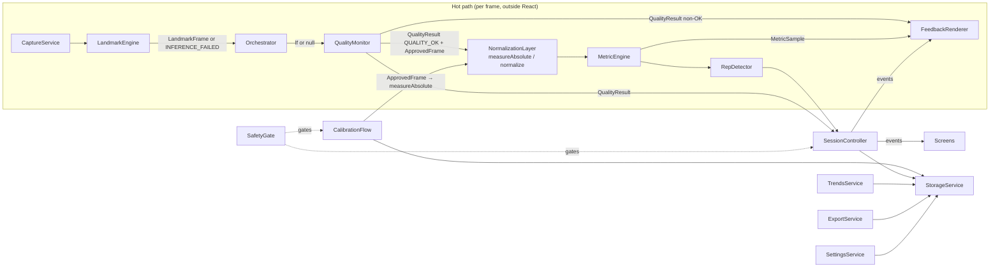

# MirrorWell — BACKEND.md

> **For AI coding agents:** "backend" = the local service layer (`src/sensing/`, `src/metrics/`, `src/session/`, `src/data/`). There is no server. Read `ARCHITECTURE.md` §12 for canonical identifiers, §13 for exact type shapes, and `API.md` for the exact public contracts before modifying any service. Global non-negotiables: **no network calls; no persistence of frames/landmarks; metric code never runs on a non-`QUALITY_OK` frame (`ApprovedFrame` type barrier — ARCHITECTURE §13); every tunable lives in `src/config/thresholds.ts`; every user-facing string lives in `src/config/strings.ts`.**

## 1. Service internals

### 1.1 `CaptureService` (`src/sensing/capture.ts`)

Responsibility: own the camera lifecycle and frame loop; nothing else.

```typescript
start(constraints?: MediaTrackConstraints): Promise<void>   // throws CAMERA_DENIED | CAMERA_UNAVAILABLE
stop(): void                                                // must release tracks (camera light OFF)
onFrame(cb: (video: HTMLVideoElement, timestampMs: number) => void): () => void  // returns unsubscribe
onStop(cb: () => void): () => void                          // abort signal, fired after tracks release
isRunning(): boolean
```

Internals: `getUserMedia({video: {facingMode: 'user', width: {ideal: 640}, height: {ideal: 480}}})`; frame loop via `video.requestVideoFrameCallback` with `requestAnimationFrame` fallback (detect once at startup, log which). The callback delivers the live `HTMLVideoElement` + timestamp — no `VideoFrame`/WebCodecs construction (MediaPipe's `detectForVideo` accepts the video element directly; this also sidesteps a Firefox WebCodecs compatibility risk). The timestamp is the **performance-clock** value (`requestVideoFrameCallback`'s `now` argument / `requestAnimationFrame`'s tick argument), **never** `metadata.mediaTime`: `mediaTime` restarts near 0 with every new `MediaStream`, while `LandmarkEngine`'s landmarker is a singleton that outlives camera restarts, and `detectForVideo` requires monotonically increasing timestamps for the landmarker's lifetime — one backwards timestamp poisons the MediaPipe graph unrecoverably ("Packet timestamp mismatch", google-ai-edge/mediapipe#5743) and every later frame reads FACE_LOST until page reload. Latest-frame-wins: if a callback is still processing, drop the incoming tick — **never queue frames** (queuing trades latency for staleness; a therapy mirror must be live).

`stop()` never clears the `onFrame` subscriber set: `SessionScreen`'s pause → resume stops and restarts the camera on the same subscription, so dropping subscribers would silently kill the session on resume. It instead announces itself via `onStop` (API §4), which is how the two capture windows — which close only on an arriving frame — abort instead of hanging and orphaning a subscriber for the page lifetime (two `detect()` per frame in the next session).

**Never:** hold more than one frame in memory; keep the stream open outside `CalibrationScreen`/`SessionScreen` in production (narrow exception: dev-only harnesses under `src/dev/`, excluded from the prod bundle — API.md §4); auto-restart after `stop()` without an explicit user action.

### 1.2 `LandmarkEngine` (`src/sensing/landmarks.ts`)

Responsibility: frames in, `LandmarkFrame` out. The only ML call site in the codebase.

```typescript
init(): Promise<void>                     // loads /wasm runtime + /models/face_landmarker.task; throws MODEL_LOAD_FAILED
detect(video: HTMLVideoElement, timestampMs: number): LandmarkFrame  // throws NOT_INITIALIZED | INFERENCE_FAILED
isReady(): boolean
```

Internals: `FilesetResolver.forVisionTasks('/wasm')` pointed at the **bundled** tasks-vision WASM runtime — copied from `node_modules/@mediapipe/tasks-vision/wasm/` into `public/wasm/` by `scripts/copy-wasm.ts` at postinstall (the standard CDN-loading examples would break the no-network gate and the offline PWA). FaceLandmarker in VIDEO running mode via `detectForVideo(video, timestampMs)`, `outputFacialTransformationMatrixes: true`, `outputFaceBlendshapes: true` (per-side expression coefficients — measurement source for candidate blendshape-si-v1), `numFaces: 1`, option thresholds `minFaceDetectionConfidence` / `minFacePresenceConfidence` / `minTrackingConfidence` from `thresholds.ts` (defaults 0.5 — the only confidence controls the API has); GPU delegate with WASM fallback (backend not asserted; WebGPU unverified for 0.10.35 — detect once, log which). `LandmarkFrame.facePresent` = `faceLandmarks` non-empty (`FaceLandmarkerResult` has no per-frame confidence field). Model **and** WASM runtime files are hash-verified at postinstall (`scripts/verify-model.ts` compares SHA-256s against `models.lock.json`).

`detect()` clamps the timestamp it feeds `detectForVideo` to be strictly increasing over the landmarker's lifetime (a non-increasing input is nudged forward 1 ms; the returned `LandmarkFrame` keeps the caller's timestamp). `CaptureService` already supplies a monotonic clock (§1.1), so the clamp is a belt-and-braces guard against the unrecoverable "Packet timestamp mismatch" graph poisoning described there.

**Never:** fetch the model or the WASM runtime from a CDN at runtime; expose MediaPipe types outside this module (everything downstream sees only `LandmarkFrame`); return blendshapes to downstream code (MODEL_AND_DATA §2 — raw landmark geometry only).

### 1.3 `QualityMonitor` (`src/sensing/quality.ts`)

Responsibility: return exactly one discriminated `QualityResult` per frame; the fail-safe core and sole constructor of `ApprovedFrame`.

```typescript
evaluate(video: HTMLVideoElement, lf: LandmarkFrame | null): QualityResult
// QualityResult = { state: 'QUALITY_OK', frame: ApprovedFrame }
//               | { state: Exclude<QualityState, 'QUALITY_OK'> }  // no frame key
// shapes: ARCHITECTURE §13
```

Gate order (first failure wins): `FACE_LOST` (`lf === null` or `facePresent === false` — i.e. empty `faceLandmarks`; sensitivity is governed by the FaceLandmarker option thresholds in §1.2, not by any per-frame score) → `LOW_LIGHT` (mean luma over the **face bounding box** — landmark AABB +10% margin, sampled from a 64×64 downsample of the video — < `lumaMin` 60/255) → `TOO_FAR` (inter-ocular distance < `interOcularMinFrac` × video width, `0.09`; fractional so the same face scale passes at 640×480 and 1280×720) → `POSE_OUT_OF_RANGE` (|yaw|, |pitch| or |roll| from `headPose` > `poseMaxDeg` 15°) → `LOW_CONFIDENCE` (rolling RMS **second difference** of landmarks `|p_t − 2p_{t−1} + p_{t−2}|` / IOD > `jitterMaxPct` 0.005 — motion-compensated: constant-velocity intentional motion ≈ 0, oscillating tracking noise fails; needs ≥3 frames) → `QUALITY_OK` (construct branded `ApprovedFrame` with `lf` + `video.videoWidth`/`videoHeight`). All values from `thresholds.ts`.

**Intended gate-order note:** face-region luma requires landmarks, so a face too dark to detect yields `FACE_LOST`, not `LOW_LIGHT` — acceptable and honest (the UX still prompts lighting/position adjustment). **Jitter assumption:** second difference is computed per sample without Δt scaling and assumes approximately uniform frame intervals; threshold is tuned against fixtures.

`INFERENCE_FAILED` is converted by the **orchestrator** (SessionController / harness) before `evaluate`: catch from `LandmarkEngine.detect`, call `evaluate(video, null)` → `{ state: 'FACE_LOST' }`.

**Never:** return more than one state; construct `ApprovedFrame` outside this module; phrase any state as a statement about the user's face or health (strings live in `strings.ts` and describe *conditions*: light, distance, angle — see SAFETY §8). Type barrier: `normalize` / `measureAbsolute` accept only `ApprovedFrame` — bad-frame metrics are a compile error.

### 1.4 `NormalizationLayer` (`src/metrics/normalize.ts` + geometry kernel `src/metrics/geometry.ts`)

Responsibility: make geometry comparable across scale, lighting, and sessions via a baseline-free measurement kernel and baseline-relative normalization. Canonical math: ARCHITECTURE §7.

```typescript
// Geometry kernel (src/metrics/geometry.ts) — baseline-free bootstrap (DG-2)
measureAbsolute(af: ApprovedFrame): AbsoluteFeatures   // face-local Vec2 features in IOD units; ARCHITECTURE §13

// NormalizationLayer
setBaseline(b: CalibrationBaseline): void              // throws NO_BASELINE if b invalid
normalize(af: ApprovedFrame): NormalizedFrame          // throws NO_BASELINE only
clearBaseline(): void
```

**Kernel internals (`measureAbsolute`)** — per ARCHITECTURE §7:

1. Pixel-space: `P = (x·W, y·H)` from `ApprovedFrame.lf.landmarks` + `videoWidth`/`videoHeight` (aspect-correct; Z excluded in v1).
2. Face-local frame from eyes 33/263: origin, IOD, `û` (anatomical left), `v̂` (toward forehead). **No inverse-rotation pose correction** — roll free from eye alignment; yaw/pitch bounded by the quality gate only.
3. Per region/side: `f = ((P_moving − P_anchor) · (û, v̂)) / IOD` → `{u, v}` using the region anchors in §7.

**Normalize pipeline** per approved frame: (1) `measureAbsolute(af)` → face-local vector features per region/side (`AbsoluteFeatures`); (2) subtract stored vector `neutralStats` component-wise → vector `regionDisplacements` (ARCHITECTURE §13). Calibration bootstrap uses `measureAbsolute` directly — **zero/default/ephemeral baselines are forbidden**.

**Never:** run `normalize` without an explicit real baseline (no silent identity defaults, no zero `neutralStats`); accept a raw `LandmarkFrame` (compile error — `ApprovedFrame` only); mutate the input frame; consume blendshapes; apply inverse-rotation "pose correction" (isometry no-op — deleted).

### 1.5 `MetricEngine` (`src/metrics/metrics.ts`) and `RepDetector` (`src/metrics/reps.ts`)

Pure functions — no DOM, no camera, no storage; 100% branch coverage required (TESTS.md §2). Canonical math in ARCHITECTURE §7.

```typescript
// MetricEngine (stateful module singleton — holds baseline, trailing smoothing window, ease-off
// sustain timer, last sample timestamp; same pattern as NormalizationLayer §1.4)
setBaseline(b: CalibrationBaseline): void                          // throws NO_BASELINE
compute(nf: NormalizedFrame, exerciseId: ExerciseId): MetricSample // SI null under movementFloor; throws NO_BASELINE
isEaseOffActive(): boolean                                        // effortIndex > 0.60 sustained >= 300ms
getLastRaw(): RawMetricSample | null                              // dev-only, for DebugHud; null before first compute()/after reset()
reset(): void                                                     // clears smoothing window, ease-off timer, getLastRaw(), last timestamp
// RepDetector (stateful per exercise; reset() between exercises)
feed(sample: MetricSample): RepEvent | null
getState(): 'idle' | 'active'                                    // dev-only, for DebugHud
reset(): void
```

**Metric internals (per active exercise region, ARCHITECTURE §7):**

1. Read vector displacements `ΔL`, `ΔR` from `nf.regionDisplacements[regionId]`; mirror `ΔR̃ = (−ΔR.u, ΔR.v)`; magnitudes `mL = |ΔL|`, `mR = |ΔR̃|`.
2. `symmetryIndex` (candidate `blendshape-si-v1`, 2026-07-19 — supersedes the geometry-displacement source after three geometry candidates failed V1 B3; evidence `tests/analysis/rejected/` + blendshape probes): for exercises with a `blendshapePair`, `L/R = blendshapes[pair.left/right]`, `act = max(L,R)`; if `act < blendshapes.activationFloor` → `null`; else `SI = min(L,R)/max(L,R)`. Unilateral → low SI (smirk probe: 0.43); symmetric → ~1. Exercises without a pair (EX_PUCKER, open decision) → `VALIDATION_FAILED`, never a silent fallback. The geometry formula (`(min/max)·max(0,cosθ)` over mirrored displacement vectors) remains documented for the retained geometry modules but is no longer the MetricSample source.
3. `effortIndex = max(0, max(mL,mR) − neutralActivation[exerciseId]) / (comfortableMax[exerciseId] − neutralActivation[exerciseId])` (both from baseline; a missing `neutralActivation` behaves as 0 — ARCHITECTURE §7 documents why the resting rebase is required for pairs with nonzero neutral reads like `browOuterUp`/`eyeBlink`).
4. Smooth both with a **trailing** 5-frame median (frames `t−4..t` only).
5. **Gap rule:** if `timestampMs` gap from previous sample > `metrics.gapResetMs` (250): reset smoothing window + ease-off sustain; if `RepDetector` is `active`, abort the rep without emitting an event.

**Never:** emit a rep shorter than `repMinDurationMs`; carry state across exercises (SessionController must call `reset()` — a unit test asserts leakage impossible); round or clamp values before storage (store raw, format only in UI); use a centered median window (lookahead forbidden).
### 1.6 `SessionController` (`src/session/controller.ts`)

Responsibility: the session state machine, the event surface, session assembly.

```typescript
start(exerciseIds: ExerciseId[]): Promise<void>   // throws NOT_ATTESTED | NO_BASELINE | CAMERA_* 
advance(): void                                   // user taps "I'm ready" / "next"
extendRest(seconds: number): void                 // extension only; shortening does not exist
stop(reason: EndReason): Promise<SessionRecordFull> // always saves partials (except Demo Mode); shape: ARCHITECTURE §13
on<E extends SessionEvent>(event: E, cb): () => void  // events: ARCHITECTURE §12, no others
```

State machine per exercise: `DEMO → REPS → REST`; transitions: `advance()` (DEMO→REPS), rep count reached (REPS→REST), `restSeconds` elapsed or `advance()` (REST→next exercise DEMO or session end). Hot-path orchestration: on each frame, catch `INFERENCE_FAILED` → `evaluate(video, null)`; on `QualityResult` with `state === 'QUALITY_OK'`, pass `frame` (`ApprovedFrame`) to `normalize` / metrics; otherwise emit `qualityUpdate` and skip geometry. Quality problems persisting > 30 s in REPS → offer stop (`quality_abandoned`). Rep discard rule: < 60% `QUALITY_OK` frames within the rep window → not counted, silently: no event is emitted for a discarded rep (the `repCompleted` emission sits inside the ≥ 60% branch), and none of the closed 7-event surface (ARCHITECTURE §12) carries a discard event.

**Never:** start unattested (Demo Mode excepted, `SafetyGate` decides); write to storage when `SafetyGate.isDemoMode()` is true; auto-progress difficulty or dosing (dosing is fixed config — the app never prescribes); emit events not listed in ARCHITECTURE §12; pass a raw `LandmarkFrame` into `normalize` / `measureAbsolute`.

### 1.7 `CalibrationFlow` (`src/session/calibration.ts`)

```typescript
captureNeutral(): Promise<NeutralCaptureResult>                 // 3×3 s, measureAbsolute + median; also records neutralActivation[exerciseId] = median resting max(L,R) per assigned exercise (the effort rebase, ARCHITECTURE §7); throws QUALITY_TOO_LOW
captureComfortableMax(exerciseId: ExerciseId): Promise<number>  // 3 gentle reps, median peak blendshape activation max(L,R), 0..1 units; throws QUALITY_TOO_LOW (also when the median peak − neutralActivation[exerciseId] < thresholds.blendshapes.activationFloor — the peak must clear the RESTING read, since an absolute floor passes pairs whose neutral read is already nonzero, e.g. eyeBlink/browOuterUp; a held-still capture yields a noise-level comfortableMax that makes effortIndex read any facial motion, incl. cross-activation bleed from unrelated movements, as a full-effort rep); no blendshapePair → VALIDATION_FAILED
runNoiseFloorSelfTest(): Promise<number>                        // noiseFloorSymmetry (API §11): std of smoothed SI during held comfortable-max
// noiseFloorDisplacement (activation std at neutral, B1a) is computed inside captureNeutral;
// both floors are written onto calibration_baseline by saveBaseline — never into app_settings (DG-4)
checkBaselineDrift(): Promise<'ok' | 'recalibrate'>             // 3 s silent re-check; see drift statistic below
```

`captureNeutral` uses the baseline-free geometry kernel `measureAbsolute` on `QUALITY_OK` `ApprovedFrame`s, aggregates to vector `NeutralStats` (ARCHITECTURE §13), and returns `{ neutralStats, qualityScore }`. **Never** invents a zero/default baseline to call `normalize` during bootstrap.

**Noise-floor self-test (writes `calibration_baseline` fields):**

- `noiseFloorDisplacement` — std of pre-floor `max(mL, mR)` over neutral `QUALITY_OK` frames (B1a).
- `noiseFloorSymmetry` — std of smoothed SI over held comfortable-max captures for the calibrated exercises (B1b; SI is defined during held expression).

Both land on the same `CalibrationBaseline` row via `StorageService.saveBaseline`.

**Baseline-drift statistic (P1-11):** during the silent 3 s re-check, for each region/side compute pre-floor displacement magnitude of the current neutral vs stored neutral: `|m_current − m_neutral|`. Aggregate as the **median across regions**. If that median exceeds `calibration.driftMaxPct` (0.08) → `'recalibrate'`; else `'ok'`.

**Never:** accept a capture with `qualityScore < 0.7`; use max instead of median for `comfortableMax` (median resists the straining outlier); write noise floors into `app_settings`; persist anything in Demo Mode (its quick-calibration lives in memory only).
### 1.8 `SafetyGate` (`src/session/safety.ts`)

```typescript
isAttested(): Promise<boolean>            // profile.consentVersion === VITE_CONSENT_VERSION && attestedAt != null
recordAttestation(v: string): Promise<void>
enterDemoMode(): void                     // in-memory flag; ARCHITECTURE §11 rules
isDemoMode(): boolean
```

**Never:** persist the demo flag; expose any bypass of attestation other than `enterDemoMode` with its full rule set (watermark, no writes, blocked screens, reload exits).

### 1.9 `StorageService` (`src/data/storage.ts`)

Sole owner of `mirrorwell_db` (DATABASE.md). Contracts in API.md §3. Internals worth stating:

- `saveSession` writes `session_record` + `exercise_result`s + `rep_metric`s in **one** `db.transaction('rw', ...)` — a thrown error anywhere leaves zero rows.
- `saveBaseline` flips `isActive` (old → 0, new → 1) inside the same transaction as the insert.
- Every write validates against the DATABASE.md §3 matrix first; `isDemoMode()` short-circuits all writes with a thrown `VALIDATION_FAILED` (`demo mode is read-only`) — callers must never reach this in practice.
- `deleteAllData` clears all six tables in one transaction, then `SafetyGate` state resets (next open → onboarding).

### 1.10 `TrendsService`, `ExportService`, `SettingsService` (`src/data/`)

```typescript
TrendsService.getTrend(exerciseId: ExerciseId, granularity: 'weekly'|'monthly'): Promise<TrendSeries>
TrendsService.getAdherence(range: {from: string; to: string}): Promise<{sessionsPerWeek: number[]; completionRate: number}>
ExportService.generateSummary(range: {from: string; to: string}): Promise<{json: Blob; html: Blob}>
SettingsService.get(): Promise<AppSettings>
SettingsService.update(partial: Partial<AppSettings>): Promise<AppSettings>
```

`TrendsService` buckets stored UTC timestamps into **local-time** periods: Monday-start ISO weeks and local calendar months. It **never** mixes `baselineId`s in one series; excludes `quality_abandoned` and `red_flag_stopped` sessions, null `meanSymmetryIndex` values, and empty periods from the returned points; and marks the first point `aboveNoiseFloor: true`. Later points compare with the nearest preceding non-empty period, even across empty calendar periods, and are `aboveNoiseFloor: false` only when the absolute change is below the **active baseline's** `noiseFloorSymmetry` (baseline-paired source — never `app_settings`).

`ExportService` widens calendar-date ranges to UTC day boundaries before reading sessions, while `TrendsService` still assigns those sessions to local-time buckets. A session near a UTC midnight can therefore be inside the export range but belong to a different local day or week; range membership and trend bucketing intentionally use those different boundaries. `ExportService` **never** adds fields beyond `tests/schemas/export.schema.json`, never auto-shares (download only), and always embeds the non-diagnostic header (SAFETY §5); export `noiseFloorSymmetry` is read from the active `calibration_baseline`.

## 2. Internal call graph



No queues, no streams, no workers in v1. The single "scheduler" is a **date-only** staleness check on `HomeScreen` mount: compare the active baseline's `capturedAt` against `staleDays` (14, design default, **needs verification**) — **no camera involved**; the camera opens only on `CalibrationScreen`/`SessionScreen` in production (dev harnesses under `src/dev/` may open it — API.md §4). The 3 s `CalibrationFlow.checkBaselineDrift()` capture runs only inside `SessionController.start` preconditions, where the camera is legitimately live.

## 3. State & long-running work

- **Hot-path state** lives in plain TS module singletons, never React state (React renders at UI cadence off `SessionController` events, throttled ~15 Hz; canvas overlay draws at full fps).
- **Long-running work:** only `LandmarkEngine.init()` (~1–3 s model load) — run during a visible loading state before `CalibrationScreen`/`SessionScreen`, never lazily mid-session. There is no video processing job: video is never stored, so there is nothing to process later. This is a feature, not a gap.
- **Interruption handling:** tab hidden / device sleep mid-session → `visibilitychange` pauses the session (state preserved in memory); tab killed → nothing was lost that matters (completed reps of completed exercises are only persisted at `stop()`; an unfinished session that dies mid-way simply never existed in the DB — acceptable for v1 and documented in FRONTEND.md).

## 4. Logging, error handling, monitoring

- Logger: `src/log.ts` — `log.debug|info|warn|error(scope: string, msg: string, data?: object)`. Console-only. Production builds strip `debug`/`info` (Vite define); `warn`/`error` survive production, which is exactly why the logger does **not** live in `src/dev/` (that directory is excluded from prod builds and holds only `DebugHud`). **There is no remote logging, crash reporting, or telemetry, and none may be added** — that would be a network call carrying health-adjacent data.
- **Never log:** landmark arrays, frames, or anything derived from the camera at `warn`/`error` level (these survive in prod consoles); any string from `strings.ts` interpolated with metric values (keeps health data out of logs).
- Errors: everything throws `MirrorWellError { code: ErrorCode; message: string; recoverable: boolean }` (codes: ARCHITECTURE §12; shapes: API.md §1). Screens map `code` → user-facing text from `strings.ts`; raw `message` is for the console only.
- "Monitoring" = the user-visible honesty surfaces: `lowQualityFramePct` per session and the `DebugHud` (dev). No production telemetry, by design.

## 5. Running the backend alone

```bash
npm install
npm run test:unit -- --watch      # Vitest over sensing/metrics/data with fake-indexeddb — the backend REPL
npm run seed:dev                  # Node-only: seeds fake-indexeddb for unit tests (DATABASE.md §6).
                                  # The BROWSER db is seeded via the DebugHud "seed" button, not this script.
npx tsx scripts/inspect-db.ts     # dumps mirrorwell_db tables as JSON to stdout (dev utility, to be written in Task 2)
npm run dev                       # full app; open the DebugHud (VITE_ENABLE_DEBUG_HUD=true) to watch the hot path live
```

Headless verification without a camera: Playwright launches Chromium with `--use-fake-device-for-media-stream --use-file-for-fake-video-capture=tests/fixtures/replay/<clip>.mjpeg` (TESTS.md §1). Chromium's fake capture accepts **only `.y4m` or `.mjpeg`** — masters are recorded as webm/mp4 and converted with `scripts/convert-fixtures.sh` (ffmpeg); y4m is rejected because it is uncompressed and far too large to commit. This is the mechanism agents should use to exercise the hot path deterministically.
