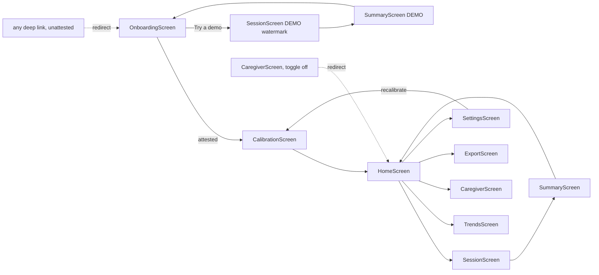

# MirrorWell — FRONTEND.md

> **For AI coding agents:** screens consume **only** the contracts in `API.md` and the six `SessionController` events — nothing else. Every user-facing string comes from `src/config/strings.ts` (never inline literals; SAFETY §8 audits that file). Every screen must pass the §4 accessibility requirements and the axe-core scan (TESTS.md). Users are adults with one-sided facial weakness, often older, sometimes with strained vision — calm, large, unhurried UI is a correctness requirement here, not a style preference.

## 1. Navigation map



Route guard rules (React Router or equivalent): UNATTESTED → everything redirects to `OnboardingScreen`; DEMO → only `SessionScreen`/`SummaryScreen` reachable (watermarked), plus `OnboardingScreen`, which is demo's **exit** and clears the flag on mount (ARCHITECTURE §11, API §2 `exitDemoMode`); `CaregiverScreen` additionally requires `caregiverViewEnabled === true`.

### 1.1 Layout system

One dynamic, responsive app — no separate mobile build, no separate "mobile layout" and "desktop layout" markup. Desktop-first, calm-clinical (generous whitespace, muted sage/slate palette, one accent). **The only discrete (breakpoint-driven) layout change in the app is nav chrome** — `AppShell`'s sidebar (≥1024px `lg`) vs. bottom tab bar (below it). Everything else — type, spacing, container width, multi-item layout — is continuous: `clamp()` fluid tokens and CSS Grid `auto-fit`, not `md:`/`lg:` variants that swap between two discrete states. Dragging the window from 390px to 1920px must never visibly "snap" (owner craft feedback, 2026-07-24, second pass — the first pass still re-capped every screen to one centered column and used `md:grid-cols-2` breakpoint swaps for grids, which read as "a mobile app stretched onto desktop").

- **Fluid design tokens (`src/index.css` `:root`, wired in `tailwind.config.js`):** `--step-sm` … `--step-3xl` (type) and `--space-xs` … `--space-xl` (spacing/padding) are `clamp()`-based CSS custom properties, not fixed px. They override Tailwind's default `fontSize` keys of the same name (`sm`/`base`/`lg`/`xl`/`2xl`/`3xl`) and add new `spacing` keys (`xs`/`sm`/`md`/`lg`/`xl`), so most existing `text-*`/`p-*`/`gap-*` utilities across the app scale continuously with viewport width for free.
- **`ScreenShell` width variants** (`variant` prop, `src/components/layout/ScreenShell.tsx`):
  - `reading` (default) — centered, capped at `max-w-shell` (`--shell-width`, fluid ~20–44rem). The **only** narrow-column screen: `OnboardingScreen`. Widened past strict prose (38rem→44rem) so the attestation/exercise `.fluid-grid` steps can reach 2 columns before the cap bites.
  - `wide` — **no max-width at all**. Fills `AppShell`'s fluid `flex-1` main beside the sidebar (`HomeScreen`, `TrendsScreen`, `SummaryScreen` (see below), `CaregiverScreen`, `ExportScreen`, `SettingsScreen`). Content spread at that width is `.fluid-grid`'s job, not a container cap — re-imposing a max-width here is exactly the bug this pass fixes. Screens with genuinely linear (non-grid) content — `ExportScreen`'s form flow, `SettingsScreen`'s danger-zone/recalibrate footer, footer back-links — cap only their own inner content column with `max-w-shell` (no breakpoint, so still continuous), leaving the outer shell uncapped.
  - `standalone` cap (`max-w-standalone`, `--shell-width-standalone`, fluid ~20–64rem) — for the two screens that are `wide` but **never** `AppShell`-wrapped (no sidebar to fill beside): `SessionScreen`'s in-session scaffold (replaces the old hard `lg:max-w-5xl` jump) and `SummaryScreen` (centered via `mx-auto`, replacing the old `md:max-w-shell-wide`). "Fills up to a sane max" — fluid, not a breakpoint, but bounded so a celebration message or the capture stage doesn't stretch edge-to-edge at 1920px.
- **`.fluid-grid` (`src/index.css` utilities):** `display: grid; grid-template-columns: repeat(auto-fit, minmax(min(100%, 20rem), 1fr))`. Columns appear/vanish continuously as the container widens — never a `md:grid-cols-2` snap. Used for same-kind tile collections: `HomeScreen` (garden + milestones span the full row via `[grid-column:1/-1]`, the empty/last-session/recalibration cards are the tiles), `SettingsScreen`'s three setting groups, `SummaryScreen`'s per-exercise result cards, `CaregiverScreen`'s note+status cards and its per-exercise trend panels, and `CheckboxGroup` (onboarding attestation/exercise lists, shared by any screen-local checklist UI). **Not** used for asymmetric toolbar+content compositions (e.g. `TrendsScreen`'s controls-then-chart) — auto-fit with only 2 dissimilar children stretches them into oversized, awkward cells; those stay a plain stacked column with the toolbar capped and the content (a `recharts` `ResponsiveContainer`) left free to fill available width.
- **Hub shell (sidebar ≥1024px / bottom tab bar <1024px):** wraps exactly the hub screens shown fanning out from `HomeScreen` in the map above — `HomeScreen`, `TrendsScreen`, `ExportScreen`, `SettingsScreen`, `CaregiverScreen`. Nav items: Home, Trends, Export, Settings, and Caregiver only when `caregiverViewEnabled`. Implemented as a layout route (`AppShell`, a shell-local component per §12's "screen-local presentational components are implementation detail" note — not a glossary identifier) nested inside the existing ATTESTED `GateRoute`, sibling to `CalibrationScreen` which stays outside it. `AppShell`'s content area is plain `flex-1 min-w-0` — it does not itself cap width; `ScreenShell`'s `wide` variant relies on that.
- **Never shelled:** `OnboardingScreen` (stepper owns the viewport), `CalibrationScreen` (camera-top layout owns the viewport), `SessionScreen`/`SummaryScreen` (the session flow is distraction-free by construction — it is simply never mounted inside the hub shell, so there is no phase-aware chrome toggle to get wrong; both use the `standalone` cap above since there's no sidebar to fill beside).
- All of the above is Tailwind utility classes (arbitrary-property `[grid-column:1/-1]` included) or the one `.fluid-grid` CSS rule — no JS media queries, no `md:`/`lg:` grid-column swaps anywhere outside `AppShell`'s own nav chrome.

## 2. Screens

### 2.1 `OnboardingScreen`

- **Purpose:** safety gate + consent (SAFETY §2); the only entry point when UNATTESTED.
- **Layout:** single-column stepper, one concept per step: (1) what MirrorWell is/is not (intended-use, plain language); (2) red-flag education incl. "**new or sudden facial droop is a medical emergency**"; (3) local-processing consent ("your face is processed on this device and never stored or sent anywhere"); (4) four attestation checkboxes; (5) optional "About you" (nickname + motivation/"why" — dedicated page after consent so the name is not buried under legal boxes; skippable; prefilled from any existing local profile on re-onboarding); (6) assigned-exercise selection (checkbox list of the four `EX_*` with plain names). Footer: "Try a demo" (secondary, always visible).
- **Components:** stepper, checkbox group, optional profile fields, exercise picker, demo entry button.
- **States:** *success* → on the final step, save in this **mandatory order**: `StorageService.saveProfile` (with the selected `assignedExercises`) **first**, then `SafetyGate.recordAttestation` (attestation requires an existing valid profile and throws `VALIDATION_FAILED` otherwise — API.md §2) → `CalibrationScreen`; *error* `DB_UNAVAILABLE` → blocking notice (Demo still offered); *loading* trivial. No empty state.
- **Calls:** `SafetyGate.isAttested` (mount), `StorageService.saveProfile`, `SafetyGate.recordAttestation` (in that order), `SafetyGate.enterDemoMode`.
- **Rule:** the continue button stays disabled until all four checkboxes are checked — `recordAttestation` must be uncallable otherwise (TESTS.md asserts).

### 2.2 `CalibrationScreen`

- **Purpose:** capture baseline (ARCHITECTURE §4 steps 3–5) with live coaching.
- **Layout:** camera preview (mirrored) top; instruction card center ("relax your face…"; keep whole face — eyebrows and forehead — in the oval); progress dots for the 3 captures; live quality banner driven by §5 states; large Capture/Redo buttons; secondary **Not now** (outline) leaves to `HomeScreen` and stops the camera — never traps the user on a live preview.

- **Viewport composition:** the interactive calibration surface is a viewport-locked flex stage. The journey bar, current instruction, `CaptureProgress`, and primary action band never shrink below the fold on laptop/desktop viewports; the camera preview takes and yields the remaining height (`min-height: 0`) instead of forcing those controls off-screen. The same continuous hierarchy remains usable at phone widths.
- **States:** *loading* — `LandmarkEngine.init()` with progress ("warming up the camera — about 3 seconds"); *error* — `CAMERA_DENIED`/`CAMERA_UNAVAILABLE` guidance with retry, `QUALITY_TOO_LOW` → coaching + redo (never a dead end), `MODEL_LOAD_FAILED` → blocking retry; *success* — per-step confirmation, then comfortable-max flow per assigned exercise ("gentle — do not strain" in the copy, API §11 rule), then noise-floor self-test (invisible to the user beyond "one more quiet moment"), then `HomeScreen`.
- **Calls:** `LandmarkEngine.init`, `CaptureService.start/stop`, `CalibrationFlow.captureNeutral/captureComfortableMax/runNoiseFloorSelfTest`, `StorageService.saveBaseline`.

### 2.3 `HomeScreen`

- **Purpose:** single-decision hub.
- **Layout:** one primary button immediately follows the greeting and remains the visual priority — **"Start my exercises"** when the active baseline covers every assigned exercise's gentle-max; **"Calibrate to begin"** (routes to `CalibrationScreen`) when there is no active baseline or any assigned exercise is missing `comfortableMax` (never open `SessionScreen` for uncalibrated exercises). `AdherenceGarden` is a quieter secondary surface showing the last eight Monday-start local calendar weeks as readable illustrated plots (seed/sprout/leaf/bloom = 0/1/2/3+ sessions); last-session line ("Tuesday — all exercises done"); derived milestone badges that celebrate practice only; needs-calibration card when coverage is incomplete; recalibration prompt card when the active baseline is complete but `capturedAt` is older than `staleDays` — a **date-only comparison; no camera ever opens on this screen** (BACKEND §1.1 camera rule; the 3 s `checkBaselineDrift` capture runs inside `SessionController.start`); quiet links: Trends, Export, Settings; Caregiver View entry **only** when enabled.
- **States:** *empty* (no sessions yet) — encouraging first-run copy, no guilt; *error* `DB_UNAVAILABLE` → blocking notice; *success* default.
- **Calls:** `StorageService.getSessions` (local session history: last-session line, garden, and milestones), `StorageService.getActiveBaseline` (date comparison + comfortableMax coverage vs `assignedExercises`), `SettingsService.get`.
- **Rule:** no streaks, no "you missed X days" — missed sessions change nothing on this screen (SAFETY §8.8). The garden only grows: a week without a session stays a seed and never changes an earlier plant.

### 2.4 `SessionScreen`

- **Purpose:** the product. Guided exercise loop with live feedback.
- **Layout:** mirrored camera preview; patient-primary `GentleTarget` semicircle driven by the smoothed `effortIndex`, with the target zone and pacing highlight; secondary symmetry context; coach/hold line; rep counter; exercise name and instruction; persistent **Stop** button (top-right, ≥ 48 px); quality banner area (§5). DEMO keeps the watermark and inline quick setup (ARCHITECTURE §11). NON-DEMO keeps the user-dismissed arrival overlay over the live preview before reps begin. Every canvas value has an equivalent DOM live status, and non-OK quality freezes every moving affordance.
- **Viewport composition:** active sessions are a viewport-locked flex stage. The camera/`GentleTarget` region shrinks into the available height while the rep counter, quality/status strip, coach/hold copy, and session actions remain in a non-shrinking always-visible band. The camera remains the dominant surface, but critical feedback never requires scrolling at laptop or desktop heights.
- **Components:** `FeedbackRenderer` canvas, rep counter, instruction card, stop button, rest timer (REST state, with "+30 s" extend button — no shorten).
- **Teaching and feedback:** `ExerciseTeachOverlay` appears once per exercise per session (in-memory only) and remains available through “Show me how.” `GentleTarget` guides raise → hold (`reps.minDurationMs`) → relax from the same smoothed `effortIndex` as the unchanged rep FSM; its countdown resets on zone exit and the metric gap reset. Above-zone ease-back copy owns the screen and never presents a hold-complete release cue. The canvas is decorative and `aria-hidden`; each presented value has matching DOM `aria-live` text, and all visual progress remains frozen on non-`QUALITY_OK` frames.
- **Voice coaching (opt-in):** when `voiceCoachEnabled` is true, `VoiceCoach` uses only a local
  OS `speechSynthesis` voice for varied raise → hold → release → ease-back and rep-complete cues.
  Pacing cues inside `thresholds.feedback.voiceMinGapMs` coalesce to the latest pending cue;
  ease-back bypasses the gap, and every spoken cue cancels stale speech. Voice discovery waits for
  `voiceschanged`; `voiceName` selects an installed local voice and otherwise the best available
  local English voice is used. A missing API or no local voice silently disables speech. Turning
  the setting off cancels speech. Voice quality is OS-provided and has an offline ceiling; no
  network TTS is permitted.
- **States:** *loading* — model/camera warmup; *per-frame* — driven exclusively by the six `SessionController` events; *error* — camera loss mid-session → pause + guidance (not session loss); *success* — `sessionEnded` → `SummaryScreen`.
- **Calls:** `SessionController.start/advance/extendRest/stop`, subscriptions to all six events.
- **Stop flow (SAFETY §3):** Stop → "was anything wrong?" two-path dialog: "I just needed to stop" → `stop('user_stopped')`; "I felt pain / something felt wrong" → `stop('red_flag_stopped')` → static guidance page (pause exercises, contact your clinician; urgent care for severe/sudden symptoms). The app never triages.

### 2.5 `SummaryScreen`

- **Purpose:** kind session close-out. Reads the `sessionEnded` record for session details and derives the same practice-only milestone badges from local session history; nothing is stored for milestones.
- **Layout:** celebration header first: a session-wide gentleness stat framed as control practice; bordered per-exercise cards: reps done, then mean symmetry (as a filled bar, not a number-forward grade); a single-session movement note last; Done → `HomeScreen`. The celebration card uses a soft one-time CSS reveal and check-mark draw, disabled by reduced-motion preference.
- **States:** *success* only (record passed in); DEMO variant watermarked, ends at `OnboardingScreen`.
- **Rule:** no comparisons to previous sessions here — single-session numbers are inside the noise floor; trends belong to `TrendsScreen` (honesty rule, ARCHITECTURE §4.5). `weeks_4` requires a full 28-day local-date span between the earliest and latest sessions; it is a time-with-practice marker, not a streak.

### 2.6 `TrendsScreen`

- **Purpose:** honest longitudinal view.
- **Layout:** a compact bordered control surface contains the exercise selector (segmented, only `assignedExercises`) and granularity toggle (monthly default); a separate full-width bordered surface contains the Recharts line chart of `meanSymmetryIndex` per period, "steady" pill markers where `aboveNoiseFloor: false`, and plain-language caption ("your gentle smile has been getting more even over the last two months").
- **States:** *empty* — "trends appear after a couple of weeks of practice" (no fake early trends); *loading* spinner; *error* `DB_UNAVAILABLE`; *success* chart.
- **Calls:** `TrendsService.getTrend` per selected exercise; `SettingsService.get` (granularity).

### 2.7 `CaregiverScreen`

- **Purpose:** read-only trusted-person view on the patient's device (SAFETY §5), with exactly one narrow exception.
- **Layout:** bordered banner "Read-only view, enabled by the device owner"; adherence block (`getAdherence`); per-exercise mini-trends; last-session summary; data-quality line (`lowQualityFramePct` averaged, phrased as "measurement quality"); the encouragement-note compose box (below), gently distinguished from the otherwise read-only cards; link to `ExportScreen`.
- **States:** *guard* — redirect to `HomeScreen` when `caregiverViewEnabled` is false (including deep links); *empty/loading/error* as TrendsScreen.
- **Calls:** `TrendsService.getTrend/getAdherence`, `StorageService.getSessions/getEncouragementNote/saveEncouragementNote`, `SettingsService.get`.
- **Rule:** mutation confined to the encouragement-note compose box (SAFETY §5 narrow carve-out — plain text, ≤200 chars, singleton, never exported, never parsed as an instruction). Any OTHER interactive element that changes state is a review-blocking defect (TESTS.md audits every control).

### 2.8 `ExportScreen`

- **Purpose:** generate the clinician summary, and download a weekly `progressCard` PNG.
- **Layout:** a softly distinguished non-diagnostic scope notice remains visible above the bordered setup surface; date-range picker (defaults: last 8 weeks); plain-language "what's in this file" list; Generate button; after generation, download cards (JSON / printable HTML / weekly progress card) + advisory "share this only with your care team." The weekly card is also offered on the setup surface so it does not require generating the clinician summary first.
- **Weekly `progressCard`:** offscreen canvas 1080×1350, calm-clinical styling; contents = Monday-start week date range, session count, gentleness stat (reuse `gentlenessStat`), garden plant stage for the week (`min(3, sessions)`), **no raw metrics tables**. Local download only via the same `downloadBlob` helper as JSON/HTML (`canvas.toBlob` → object URL → anchor) — no Web Share API, no clipboard, no network. Same data class as the JSON export: derived aggregates the user already sees.
- **States:** *loading* during generation; *error* `DB_UNAVAILABLE`/`VALIDATION_FAILED`; *empty* — range with no sessions → "nothing to export for these dates"; *success* downloads.
- **Calls:** `ExportService.generateSummary`; `generateWeeklyProgressCard` (`src/data/progressCard.ts`).

### 2.9 `SettingsScreen`

- **Purpose:** accessibility, honesty settings, consent toggles, deletion.
- **Layout:** bordered grouped lists — **Your profile** (optional `nickname` + `motivation`, saved via `StorageService.saveProfile` — same fields as onboarding so already-attested users can edit without re-onboarding); Display (highContrast, textScale slider 100–200%, reducedFacePreview, showAffectedSideMarker); Cues (haptics — hidden on desktop, audio, voice-coach opt-in, and a local installed-voice picker); Trends (granularity); Sharing (caregiverViewEnabled with one-line explanation of what it reveals — Home only shows the Caregiver nav link when this is on); Calibration (Recalibrate now → `CalibrationScreen`); Danger zone (Delete everything → typed "DELETE" confirmation → `deleteAllData` → `OnboardingScreen`).
- **Composition:** settings use one calm column at narrow widths and a deliberate aligned two-column split when space permits. Each column is a vertical sequence of related sections rather than an auto-fit tile collage: profile, the prominent recalibration action, and Trends/Sharing form one column; Display and Cues (including voice coach + local voice picker) form the other. Danger zone is last, separated by a divider, and never competes with routine preferences.
- **States:** standard; deletion has its own confirm/progress/done micro-flow.
- **Calls:** `SettingsService.get/update`, `StorageService.saveProfile` (profile fields), `StorageService.deleteAllData`.

## 3. State management

- **Global React state (context `AppStateContext`):** `{ profile: UserProfile | null, activeBaseline: CalibrationBaseline | null, settings: AppSettings, gate: 'UNATTESTED' | 'ATTESTED' | 'DEMO' }` — owned by a single provider at the root, hydrated on boot from `StorageService`/`SafetyGate`, updated only via the API.md contracts. Nothing else is global.
- **Hot-path state** stays in the service singletons (BACKEND §3); `SessionScreen` holds only render-state derived from events (current exercise, rep count, latest smoothed sample, quality state, ease-off flag).
- **No Redux/Zustand** — one context + service events is sufficient; adding a state library is a review-blocking scope violation.

## 4. Accessibility (first-class; WCAG 2.1 AA minimum)

Global requirements (every screen, enforced by axe-core scan + manual keyboard journey, TESTS.md):

- **No time pressure anywhere:** reps user-paced; guide arc suggests, never fails; rest extends, never shortens (`extendRest` only — API §10); no timeouts on any decision.
- **Targets ≥ 48 px** (primary actions ≥ 64 px); no drag gestures; destructive actions double-confirmed; accidental-tap forgiveness.
- **Contrast AA in both themes; layouts survive `textScale` 2.0** without clipping; no color-only signals (ease-off = amber tint **+ tone + haptic on Android**); no flashing content (WCAG 2.3.1).
- **Keyboard + screen reader:** full journey operable by keyboard alone; ARIA labels on every control; live regions (`aria-live="polite"`) for quality banners and rep counts.
- **One-handed / propped-device use:** all in-session controls in large bottom/top zones; nothing requires holding the device.
- **Cognitive:** ≤ grade-8 reading level (strings audit), one instruction visible at a time, session resumable after interruption (§6).
- **Emotional (population-specific):** mirrored preview; `reducedFacePreview` ("show me less of my face"); kind summary language; no shame mechanics.

Per-screen specifics:

| Screen | Additional requirements |
|---|---|
| `OnboardingScreen` | Stepper fully linear, Back always available; checkboxes ≥ 48 px with full-row hit area; red-flag step readable by screen reader as one block |
| `CalibrationScreen` | Coaching messages also as audio cues (optional); capture never auto-fires — user taps when ready; redo unlimited without judgment copy |
| `SessionScreen` | Eye-comfort: `EX_EYE_CLOSURE` short sets (5 reps), brightness guidance; quality banner in `aria-live`; Stop reachable by single Tab from anywhere |
| `SummaryScreen` | Bars carry `aria-label` with the plain-language value ("mostly even") |
| `TrendsScreen` | Chart data available as a text table toggle for screen readers |
| `CaregiverScreen` | Same reading-level rules — caregivers are often elderly spouses |
| `SettingsScreen` | textScale slider has stepped buttons (±10%) as alternative to dragging |

## 5. Real-time feedback UX (per confidence/quality level)

What the user sees/hears at each level. **Never blame the user; describe conditions, not faces** (strings audited, SAFETY §8).

| State | Visual | Audio (if enabled) | Haptic (Android) | Scoring |
|---|---|---|---|---|
| `QUALITY_OK` + in `effortTargetZone` | Bar live, arc sweeping, calm palette | rep tick on completion | tick pulse | ✅ |
| `QUALITY_OK` + ease-off (`easeOff {active:true}`) | Amber tint, "ease off — stay gentle" chip, arc slows | soft descending tone | double pulse | ✅ (easeOffTriggered recorded) |
| `symmetryIndex: null` (< movementFloor) | Bar rests at center, no judgment | — | — | sample null, no score |
| `LOW_LIGHT` | Banner "More light needed", bar frozen + dimmed | single soft chime on state entry | — | ❌ paused |
| `FACE_LOST` | "I can't see your whole face — include eyebrows and forehead" | chime | — | ❌ paused |
| `TOO_FAR` | "Come a little closer" | chime | — | ❌ paused |
| `POSE_OUT_OF_RANGE` | "Face the camera straight on" | chime | — | ❌ paused |
| `LOW_CONFIDENCE` | "Hold steady for a moment" | chime | — | ❌ paused |
| Rep discarded (< 60% OK frames) | "That one didn't count — the light dipped. No worries." | — | — | rep not counted |
| Problems > 30 s | Card: "Conditions aren't great right now. Stop and try later?" (Continue / End session) | — | — | end → `quality_abandoned` |

**Fail-safe principle restated for the frontend:** a frozen-and-labeled bar is correct behavior; a moving bar during any non-OK state is a critical defect (TESTS.md has a dedicated test).

## 6. Interruption handling

`visibilitychange` → session pauses (state preserved in memory), camera stops (light off — privacy); on return, a "ready to continue?" card resumes at the same rep. Tab killed mid-session: unpersisted by design (BACKEND §3) — `HomeScreen` shows no trace; no guilt copy. Device rotation: layout reflows; session continues.

## 7. Local development

```bash
npm run dev                    # Vite dev server, http://localhost:5173
npm run seed:dev               # Node-only (fake-indexeddb) — used by unit tests, does NOT populate the browser DB.
                               # To seed the BROWSER db so Home/Trends/Caregiver render with data:
                               # run with VITE_ENABLE_DEBUG_HUD=true and click the DebugHud "seed" button.
VITE_ENABLE_DEBUG_HUD=true npm run dev    # HUD overlay: live QualityState, raw/smoothed indices, rep state, fps
npm run test:e2e -- --ui       # Playwright UI mode with fake camera (fixtures replay; TESTS.md §1)
npm run test:a11y              # axe-core scan of all nine screens
```

Frontend can be built entirely against seeded data + fixture clips — no real camera required until real-hardware integration (IMPLEMENTATION Task 17).
