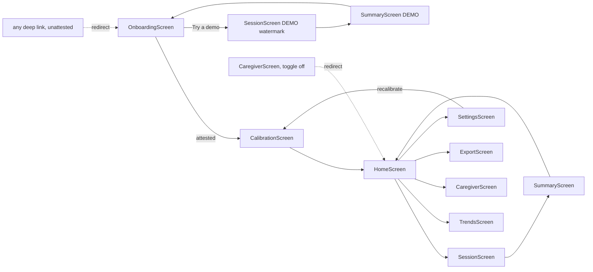

# MirrorWell — FRONTEND.md

> **For AI coding agents:** screens consume **only** the contracts in `API.md` and the six `SessionController` events — nothing else. Every user-facing string comes from `src/config/strings.ts` (never inline literals; SAFETY §8 audits that file). Every screen must pass the §4 accessibility requirements and the axe-core scan (TESTS.md). Users are adults with one-sided facial weakness, often older, sometimes with strained vision — calm, large, unhurried UI is a correctness requirement here, not a style preference.

## 1. Navigation map



Route guard rules (React Router or equivalent): UNATTESTED → everything redirects to `OnboardingScreen`; DEMO → only `SessionScreen`/`SummaryScreen` reachable (watermarked), plus `OnboardingScreen`, which is demo's **exit** and clears the flag on mount (ARCHITECTURE §11, API §2 `exitDemoMode`); `CaregiverScreen` additionally requires `caregiverViewEnabled === true`.

## 2. Screens

### 2.1 `OnboardingScreen`

- **Purpose:** safety gate + consent (SAFETY §2); the only entry point when UNATTESTED.
- **Layout:** single-column stepper, one concept per step: (1) what MirrorWell is/is not (intended-use, plain language); (2) red-flag education incl. "**new or sudden facial droop is a medical emergency**"; (3) local-processing consent ("your face is processed on this device and never stored or sent anywhere"); (4) four attestation checkboxes; (5) assigned-exercise selection (checkbox list of the four `EX_*` with plain names). Footer: "Try a demo" (secondary, always visible).
- **Components:** stepper, checkbox group, exercise picker, demo entry button.
- **States:** *success* → on the final step, save in this **mandatory order**: `StorageService.saveProfile` (with the selected `assignedExercises`) **first**, then `SafetyGate.recordAttestation` (attestation requires an existing valid profile and throws `VALIDATION_FAILED` otherwise — API.md §2) → `CalibrationScreen`; *error* `DB_UNAVAILABLE` → blocking notice (Demo still offered); *loading* trivial. No empty state.
- **Calls:** `SafetyGate.isAttested` (mount), `StorageService.saveProfile`, `SafetyGate.recordAttestation` (in that order), `SafetyGate.enterDemoMode`.
- **Rule:** the continue button stays disabled until all four checkboxes are checked — `recordAttestation` must be uncallable otherwise (TESTS.md asserts).

### 2.2 `CalibrationScreen`

- **Purpose:** capture baseline (ARCHITECTURE §4 steps 3–5) with live coaching.
- **Layout:** camera preview (mirrored) top; instruction card center ("relax your face, like you're daydreaming"); progress dots for the 3 captures; live quality banner driven by §5 states; large Capture/Redo buttons.
- **States:** *loading* — `LandmarkEngine.init()` with progress ("warming up the camera — about 3 seconds"); *error* — `CAMERA_DENIED`/`CAMERA_UNAVAILABLE` guidance with retry, `QUALITY_TOO_LOW` → coaching + redo (never a dead end), `MODEL_LOAD_FAILED` → blocking retry; *success* — per-step confirmation, then comfortable-max flow per assigned exercise ("gentle — do not strain" in the copy, API §11 rule), then noise-floor self-test (invisible to the user beyond "one more quiet moment"), then `HomeScreen`.
- **Calls:** `LandmarkEngine.init`, `CaptureService.start/stop`, `CalibrationFlow.captureNeutral/captureComfortableMax/runNoiseFloorSelfTest`, `StorageService.saveBaseline`.

### 2.3 `HomeScreen`

- **Purpose:** single-decision hub.
- **Layout:** one primary button ("Start my exercises", full-width, ≥ 64 px tall); last-session line ("Tuesday — all exercises done"); recalibration prompt card when the active baseline's `capturedAt` is older than `staleDays` — a **date-only comparison; no camera ever opens on this screen** (BACKEND §1.1 camera rule; the 3 s `checkBaselineDrift` capture runs inside `SessionController.start`); quiet links: Trends, Export, Settings; Caregiver View entry **only** when enabled.
- **States:** *empty* (no sessions yet) — encouraging first-run copy, no guilt; *error* `DB_UNAVAILABLE` → blocking notice; *success* default.
- **Calls:** `StorageService.getSessions` (last 7 days), `StorageService.getActiveBaseline` (date comparison only), `SettingsService.get`.
- **Rule:** no streaks, no "you missed X days" — missed sessions change nothing on this screen (SAFETY §8.8).

### 2.4 `SessionScreen`

- **Purpose:** the product. Guided exercise loop with live feedback.
- **Layout:** camera preview (mirrored; dimmed to 20% opacity when `reducedFacePreview` — symmetry bar becomes the primary visual); **symmetry bar** (two-sided horizontal, center-anchored; "focus side" dot per `showAffectedSideMarker`); **effort meter** (vertical gauge, left edge: fill = smoothed `effortIndex`, translucent green band = `effortTargetZone` — the gauge reps are detected on, so the user can SEE "raise into the band, hold, relax back down = one rep"; without it the symmetry bar reads as the rep indicator while moving on movements that never cross `repStartThreshold`); **guide arc** sweeping at the target pace; **coach line** — a live caption over the preview ("Raise gently into the green band" → "Lovely — hold it gently" → "A little less — settle back toward the band"), driven by the same smoothed `effortIndex` reps are detected on, and yields to quality/ease-off messages when those own the screen; **band legend** caption under the rep counter explaining the green target zone in plain language; rep counter ("4 of 10"); exercise name + one-line instruction; persistent **Stop** button (top-right, ≥ 48 px); quality banner area (§5). DEMO: watermark strip "DEMO — not for exercise use", and the ephemeral quick-calibration (ARCHITECTURE §11) runs here as an inline **"quick setup" overlay** (1×3 s neutral + 1 gentle rep, in-memory) before the first exercise — `CalibrationScreen` is never used in demo. While capturing, the full-screen card gives way to a slim `aria-live` phase prompt over the still-visible preview ("relax…" → "now — one gentle smile…"), so the user can see themselves and time the gentle rep to the second window; without the prompt the two windows are indistinguishable and the gentle capture measures a held-still face. NON-DEMO: after `SessionController.start()` resolves, a full-preview **arrival overlay** ("Take a slow breath… we'll begin when you're ready", a 4 s CSS breathing circle, `prefers-reduced-motion` → static) sits over the already-live camera — it never auto-dismisses (§4 no time pressure); a single "Begin" button hands off to the first exercise. Demo mode skips arrival — quick setup goes straight to reps.
- **Components:** `FeedbackRenderer` canvas, rep counter, instruction card, stop button, rest timer (REST state, with "+30 s" extend button — no shorten).
- **States:** *loading* — model/camera warmup; *per-frame* — driven exclusively by the six `SessionController` events; *error* — camera loss mid-session → pause + guidance (not session loss); *success* — `sessionEnded` → `SummaryScreen`.
- **Calls:** `SessionController.start/advance/extendRest/stop`, subscriptions to all six events.
- **Stop flow (SAFETY §3):** Stop → "was anything wrong?" two-path dialog: "I just needed to stop" → `stop('user_stopped')`; "I felt pain / something felt wrong" → `stop('red_flag_stopped')` → static guidance page (pause exercises, contact your clinician; urgent care for severe/sudden symptoms). The app never triages.

### 2.5 `SummaryScreen`

- **Purpose:** kind session close-out. Reads the `sessionEnded` record only — no new queries.
- **Layout:** celebration header first: a session-wide gentleness stat framed as control practice; per-exercise cards: reps done, then mean symmetry (as a filled bar, not a number-forward grade); a single-session movement note last; Done → `HomeScreen`. The celebration card uses a soft one-time CSS reveal and check-mark draw, disabled by reduced-motion preference.
- **States:** *success* only (record passed in); DEMO variant watermarked, ends at `OnboardingScreen`.
- **Rule:** no comparisons to previous sessions here — single-session numbers are inside the noise floor; trends belong to `TrendsScreen` (honesty rule, ARCHITECTURE §4.5).

### 2.6 `TrendsScreen`

- **Purpose:** honest longitudinal view.
- **Layout:** exercise selector (segmented, only `assignedExercises`); Recharts line chart of `meanSymmetryIndex` per period; "steady" pill markers where `aboveNoiseFloor: false`; plain-language caption ("your gentle smile has been getting more even over the last two months"); granularity toggle (monthly default).
- **States:** *empty* — "trends appear after a couple of weeks of practice" (no fake early trends); *loading* spinner; *error* `DB_UNAVAILABLE`; *success* chart.
- **Calls:** `TrendsService.getTrend` per selected exercise; `SettingsService.get` (granularity).

### 2.7 `CaregiverScreen`

- **Purpose:** read-only trusted-person view on the patient's device (SAFETY §5).
- **Layout:** banner "Read-only view, enabled by the device owner"; adherence block (`getAdherence`); per-exercise mini-trends; last-session summary; data-quality line (`lowQualityFramePct` averaged, phrased as "measurement quality"); link to `ExportScreen`.
- **States:** *guard* — redirect to `HomeScreen` when `caregiverViewEnabled` is false (including deep links); *empty/loading/error* as TrendsScreen.
- **Calls:** `TrendsService.getTrend/getAdherence`, `StorageService.getSessions`, `SettingsService.get`.
- **Rule:** zero mutating controls. Any interactive element that changes state is a review-blocking defect (TESTS.md audits every control).

### 2.8 `ExportScreen`

- **Purpose:** generate the clinician summary.
- **Layout:** date-range picker (defaults: last 8 weeks); plain-language "what's in this file" list; Generate button; after generation, two download cards (JSON / printable HTML) + advisory "share this only with your care team."
- **States:** *loading* during generation; *error* `DB_UNAVAILABLE`/`VALIDATION_FAILED`; *empty* — range with no sessions → "nothing to export for these dates"; *success* downloads.
- **Calls:** `ExportService.generateSummary`.

### 2.9 `SettingsScreen`

- **Purpose:** accessibility, honesty settings, consent toggles, deletion.
- **Layout:** grouped lists — **Your profile** (optional `nickname` + `motivation`, saved via `StorageService.saveProfile` — same fields as onboarding so already-attested users can edit without re-onboarding); Display (highContrast, textScale slider 100–200%, reducedFacePreview, showAffectedSideMarker); Cues (haptics — hidden on desktop, audio); Trends (granularity); Sharing (caregiverViewEnabled with one-line explanation of what it reveals — Home only shows the Caregiver nav link when this is on); Calibration (Recalibrate now → `CalibrationScreen`); Danger zone (Delete everything → typed "DELETE" confirmation → `deleteAllData` → `OnboardingScreen`).
- **States:** standard; deletion has its own confirm/progress/done micro-flow.
- **Calls:** `SettingsService.get/update`, `StorageService.saveProfile` (profile fields), `StorageService.deleteAllData`.

## 3. State management

- **Global React state (context `AppStateContext`):** `{ profile: UserProfile | null, activeBaseline: CalibrationBaseline | null, settings: AppSettings, gate: 'UNATTESTED' | 'ATTESTED' | 'DEMO' }` — owned by a single provider at the root, hydrated on boot from `StorageService`/`SafetyGate`, updated only via the API.md contracts. Nothing else is global.
- **Hot-path state** stays in the service singletons (BACKEND §3); `SessionScreen` holds only render-state derived from events (current exercise, rep count, latest smoothed sample, quality state, ease-off flag).
- **No Redux/Zustand** — one context + service events is sufficient; adding a state library is a review-blocking scope violation.

## 4. Accessibility (first-class; WCAG 2.1 AA minimum)

Global requirements (every screen, enforced by axe-core scan + manual keyboard journey, TESTS.md):

- **No time pressure anywhere:** reps user-paced; guide arc suggests, never fails; rest extends, never shortens (`extendRest` only — API §10); no timeouts on any decision.
- **Targets ≥ 48 px** (primary actions ≥ 64 px); no drag gestures; destructive actions double-confirmed; accidental-tap forgiveness.
- **Contrast AA in both themes; layouts survive `textScale` 2.0** without clipping; no color-only signals (ease-off = amber tint **+ tone + haptic on Android**); no flashing content (WCAG 2.3.1).
- **Keyboard + screen reader:** full journey operable by keyboard alone; ARIA labels on every control; live regions (`aria-live="polite"`) for quality banners and rep counts.
- **One-handed / propped-device use:** all in-session controls in large bottom/top zones; nothing requires holding the device.
- **Cognitive:** ≤ grade-8 reading level (strings audit), one instruction visible at a time, session resumable after interruption (§6).
- **Emotional (population-specific):** mirrored preview; `reducedFacePreview` ("show me less of my face"); kind summary language; no shame mechanics.

Per-screen specifics:

| Screen | Additional requirements |
|---|---|
| `OnboardingScreen` | Stepper fully linear, Back always available; checkboxes ≥ 48 px with full-row hit area; red-flag step readable by screen reader as one block |
| `CalibrationScreen` | Coaching messages also as audio cues (optional); capture never auto-fires — user taps when ready; redo unlimited without judgment copy |
| `SessionScreen` | Eye-comfort: `EX_EYE_CLOSURE` short sets (5 reps), brightness guidance; quality banner in `aria-live`; Stop reachable by single Tab from anywhere |
| `SummaryScreen` | Bars carry `aria-label` with the plain-language value ("mostly even") |
| `TrendsScreen` | Chart data available as a text table toggle for screen readers |
| `CaregiverScreen` | Same reading-level rules — caregivers are often elderly spouses |
| `SettingsScreen` | textScale slider has stepped buttons (±10%) as alternative to dragging |

## 5. Real-time feedback UX (per confidence/quality level)

What the user sees/hears at each level. **Never blame the user; describe conditions, not faces** (strings audited, SAFETY §8).

| State | Visual | Audio (if enabled) | Haptic (Android) | Scoring |
|---|---|---|---|---|
| `QUALITY_OK` + in `effortTargetZone` | Bar live, arc sweeping, calm palette | rep tick on completion | tick pulse | ✅ |
| `QUALITY_OK` + ease-off (`easeOff {active:true}`) | Amber tint, "ease off — stay gentle" chip, arc slows | soft descending tone | double pulse | ✅ (easeOffTriggered recorded) |
| `symmetryIndex: null` (< movementFloor) | Bar rests at center, no judgment | — | — | sample null, no score |
| `LOW_LIGHT` | Banner "More light needed", bar frozen + dimmed | single soft chime on state entry | — | ❌ paused |
| `FACE_LOST` | "I can't see you — adjust the camera" | chime | — | ❌ paused |
| `TOO_FAR` | "Come a little closer" | chime | — | ❌ paused |
| `POSE_OUT_OF_RANGE` | "Face the camera straight on" | chime | — | ❌ paused |
| `LOW_CONFIDENCE` | "Hold steady for a moment" | chime | — | ❌ paused |
| Rep discarded (< 60% OK frames) | "That one didn't count — the light dipped. No worries." | — | — | rep not counted |
| Problems > 30 s | Card: "Conditions aren't great right now. Stop and try later?" (Continue / End session) | — | — | end → `quality_abandoned` |

**Fail-safe principle restated for the frontend:** a frozen-and-labeled bar is correct behavior; a moving bar during any non-OK state is a critical defect (TESTS.md has a dedicated test).

## 6. Interruption handling

`visibilitychange` → session pauses (state preserved in memory), camera stops (light off — privacy); on return, a "ready to continue?" card resumes at the same rep. Tab killed mid-session: unpersisted by design (BACKEND §3) — `HomeScreen` shows no trace; no guilt copy. Device rotation: layout reflows; session continues.

## 7. Local development

```bash
npm run dev                    # Vite dev server, http://localhost:5173
npm run seed:dev               # Node-only (fake-indexeddb) — used by unit tests, does NOT populate the browser DB.
                               # To seed the BROWSER db so Home/Trends/Caregiver render with data:
                               # run with VITE_ENABLE_DEBUG_HUD=true and click the DebugHud "seed" button.
VITE_ENABLE_DEBUG_HUD=true npm run dev    # HUD overlay: live QualityState, raw/smoothed indices, rep state, fps
npm run test:e2e -- --ui       # Playwright UI mode with fake camera (fixtures replay; TESTS.md §1)
npm run test:a11y              # axe-core scan of all nine screens
```

Frontend can be built entirely against seeded data + fixture clips — no real camera required until real-hardware integration (IMPLEMENTATION Task 17).
